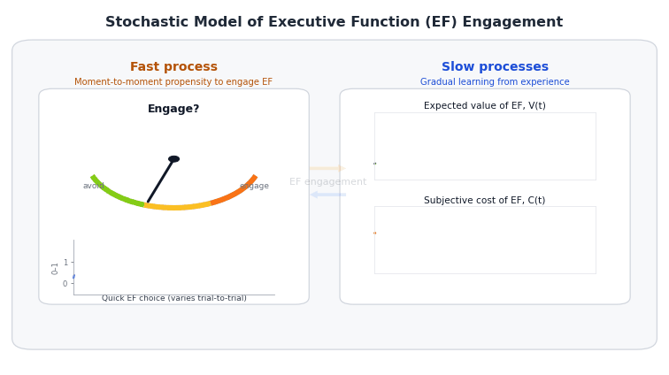

# Quick Intro

This document presents a stochastic differential equation (SDE) model of 
**executive function (EF) engagement**, based on the theory that children learn 
whether EF is *worth engaging* through experience.

> Core idea: children learn whether EF is worth engaging through experience, while EF capacity also grows gradually through maturation and practice.

The model separates:

- **Fast process (engagement):** moment-to-moment *propensity* to engage, $E(t)$
- **Slow processes (learning + development):** gradual learning of  
  - expected value of EF $V(t)$  
  - subjective cost of EF $C(t)$  
  - EF capacity $K(t)$ (monotone developmental state)

{width="100%" fig-align="center"}


The model is used to illustrate four qualitative behaviors:

1. Stable individual differences in engagement trajectories

2. Developmental improvements in capacity and typical engagement

3. Transient within-person fluctuations (e.g., stress)

4. Intervention timing effects (early vs. late reward changes)

---

# Model Overview


  
```{mermaid}
%%{init: {"theme":"base","themeVariables":{"fontFamily":"Inter, system-ui, Arial"}}}%%
flowchart LR

classDef fast fill:#E8F4FF,stroke:#1E6FB9,stroke-width:1.5px,color:#0B2A3D;
classDef slow fill:#FFF2CC,stroke:#B07D00,stroke-width:1.5px,color:#3D2B00;
classDef derived fill:#F3E8FF,stroke:#6B21A8,stroke-width:1.5px,color:#2E1065;
classDef utility fill:#E6FFFA,stroke:#0F766E,stroke-width:1.5px,color:#042F2E;
classDef param fill:#F3F4F6,stroke:#6B7280,stroke-width:1.2px,color:#111827,stroke-dasharray: 4 3;

linkStyle default stroke:#93A1AA,stroke-width:1.2px;

subgraph MAIN[" "]
direction LR

U{{Utility}}:::utility --> E(["E(t): EF engagement propensity"]):::fast

V(["V(t): learned value"]):::slow --> U
C(["C(t): subjective effort cost"]):::slow --> U
X[["extra_cost(t): stress/context"]]:::param --> U

E --> Rexp([Reward signal]):::derived
p[["p_reward(t) & reward_mag"]]:::param --> Rexp
Rexp -->|"updates expectations (+)"| V

M[[maturation]]:::param --> K(["K(t): capacity"]):::slow
E -->|"practice builds skill (+)"| K

%% --- Updated cost dynamics (mean reversion + capacity shift) ---
Cbase[["baseline cost level + mean-reversion rate"]]:::param --> C
K -->|"makes EF feel easier (—)"| C

end
style MAIN fill:transparent,stroke:transparent

subgraph LEGEND["How to read nodes"]
direction TB
L1(["FAST state (t)"]):::fast
L2(["SLOW state (t)"]):::slow
L3([Derived quantity]):::derived
L4[["Parameter / input"]]:::param
end
style LEGEND fill:#F8FAFC,stroke:#CBD5E1,stroke-width:1.2px,rx:8,ry:8


```  


## Fast Process: EF Engagement Propensity
  
At each moment $t$, the agent computes a **propensity** (interpretable as a probability or expected frequency) of engaging EF:
  
$$
  E(t) = \sigma\left(\frac{V(t) - \big(C(t) + \text{extra\_cost}(t)\big)}{\tau}\right),
\qquad \sigma(x) = \frac{1}{1+e^{-x}}.
$$

Define the *instantaneous control utility*:
$$
    U(t)=V(t)-\big(C(t)+\text{extra\_cost}(t)\big),
$$
so $E(t)=\sigma\big(U(t)/\tau\big)$.


Terms:
    
* $V(t)$: learned expected value of engaging EF
* $C(t)$: learned cost of engaging EF 
* $\text{extra\_cost}(t)$: temporary situational load (e.g., stress) that raises immediate cost
* $\tau$: decision temperature; larger $\tau$ makes the logistic mapping flatter, so engagement is ***less sensitive*** to value–cost differences $V(t)-[C(t)+\text{extra\_cost}(t)]$
* $\sigma(\cdot)$: logistic function mapping utility to $[0,1]$

  > When $V(t)$ exceeds $C(t)+\text{extra\_cost}(t)$, utility is positive and $E(t)$ moves toward 1; when costs dominate, $E(t)$ moves toward 0.
  
  
<!-- ### Capacity enters the decision through effective cost -->

<!-- EF capacity $K(t)$ reduces the experienced effort cost, so we define: -->

<!-- $$ -->
<!--   C_{\text{eff}}(t) = C(t) - \beta_K K(t), -->
<!-- $$ -->

<!-- where $\beta_K>0$ controls how strongly capacity makes EF feel easier to use. -->

<!-- * **$C(t)$** is the *subjective effort cost* of using EF right now (“this feels hard / effortful”). -->
<!-- * **$K(t)$** is *EF capacity/skill* (“how capable/efficient the child is at doing EF”). -->
<!-- * As capacity grows, the *same EF task feels less effortful* because the person can do it more efficiently. -->

<!-- So we say: -->

<!--   > “Your baseline effort cost is $C(t)$, but if you have higher capacity $K(t)$, the *effective* cost you experience is lower.” -->

<!-- That’s what $C_{\text{eff}}(t)$ is: the cost **after** accounting for capacity. -->


<!-- ::: {.callout-tip title="Why subtract?"} -->

<!-- If **capacity increases** $K(t)\uparrow$, then **effective cost decreases** $C_{\text{eff}}(t)\downarrow$. -->

<!-- That makes EF engagement more likely, because the decision utility uses $V - C_{\text{eff}}$. -->
<!-- So capacity acts like a “discount” on effort. -->
<!-- ::: -->


<!-- ::: {.callout-tip title="What does $\beta_K$ do?"} -->


<!-- $\beta_K>0$ is just a **scaling knob**: -->

<!-- * If $\beta_K$ is small, capacity barely changes experienced cost. -->
<!-- * If $\beta_K$ is large, capacity strongly reduces experienced cost. -->

<!-- You can describe it as: -->
<!-- $\beta_K$ controls how much skill translates into effort reduction. -->
<!-- ::: -->


<!-- "$C(t)$ is how effortful EF feels, and $K(t)$ is EF skill. -->
<!-- We model skill as reducing experienced effort, so the decision uses an effective cost $C_{\text{eff}}(t)=C(t)-\beta_KK(t)$, meaning ***higher capacity makes EF feel easier and therefore more likely to be engaged.***" -->


<!-- ::: {.callout-note title="One technical note " collapse="true" color="blue"} -->
<!-- This is a ***modeling choice***—one simple way to couple capacity into decisions.    -->
<!-- Another equivalent formulation would be to let capacity add to utility directly (e.g., $+ \beta_KK(t))$.   Subtracting it from cost is just cleaner conceptually: ***“capacity reduces effort.”*** -->
<!-- ::: -->

<!-- This separation is intentional: -->

<!-- * $E(t)$ can fluctuate rapidly (state-dependent engagement), -->
<!-- * $K(t)$ represents **slow developmental change** (capacity/skill), not momentary choice. -->


<!-- <br> -->


## Slow Processes: Learning and Development (SDE Dynamics)

### $K$: Capacity dynamics (slow EF development)
  
We represent EF capacity explicitly, with a bounded development state $K(t)\in[0,1]$:
  
$$
\frac{dK(t)}{dt}=\rho_{\text{mat}}\big(1-K(t)\big)+
\rho_{\text{prac}}E(t)\big(1-K(t)\big),
\qquad K(t)\in[0,1].
$$
  
* $\rho_{\text{mat}}$: basline maturational growth 
* $\rho_{\text{prac}}E(t)$: practice-driven growth (more engagement → faster capacity growth).
* $(1-K(t))$: saturation/headroom (growth slows as capacity approaches its ceiling).


::: {.callout-tip title="why (1−K)?"}
$(1−K)$ is the remaining headroom—without it, capacity would grow linearly without bound; with it, growth naturally slows near a ceiling, which matches saturating developmental improvement.”
:::


This gives a clean developmental interpretation:

* $K(t)$ is a *developmental* quantity $\rightarrow$ ***slow, monotone, saturating***,
* $E(t)$ is an *engagement* quantity $\rightarrow$ ***fast, fluctuating***,


---
  
### $V$: Value dynamics (learning “is EF worth it?”)

#### Expected reward signal (what value is learning toward)

When EF is engaged, it may yield reward. We summarize this with an ***expected rewared rate***:

$$
R^{\text{exp}}(t) \;=\; E(t)\cdot p_{\text{reward}}\cdot \text{reward\_mag}.
$$


- $E(t)\in[0,1]$: the model’s *propensity* (probability / expected frequency) of engaging EF at time $t$
- $p_{\text{reward}}\in[0,1]$: probability of receiving reward **conditional on engaging EF** $P(reward|EF engaged)$ --> captures *how rewarding the environment is* when EF is engaged (environmental payoff rate; can vary with context or interventions)
- $\text{reward\_mag}$: reward magnitude (and therefore the scale of $V$)

  

::: {.callout-tip title="Why this is considered mean-field" collapse="true"}

In a fully discrete version, two random events happen at each step:
  
1. engagement $A(t)\sim\mathrm{Bernoulli}(E(t))$
2. reward $Z(t)\sim\mathrm{Bernoulli}(p_{\text{reward}})$ conditional on $A(t)=1$

The realized reward is $R(t)=A(t)Z(t)\text{reward\_mag}$, which is noisy.

The mean-field approximation replaces that noisy realized reward with its conditional expectation:
  $$
    \mathbb{E}[R(t)\mid E(t)]=E(t)p_{\text{reward}}\text{reward\_mag}.
  $$

So “mean-field” means: we drive learning by the ***average reward signal**$ implied by the current propensity, rather than sampling binary engagement and reward each step.

:::


<br>

#### Value learning is a ***pull toward what is currently paying off***
$V(t)$ represents the child’s learned belief that “using EF is worth it.”  


Value learns toward this reward signal via a noisy error-correction process:

  
$$
  dV(t) = \alpha_V \big(R^{\text{exp}}(t) - V(t)\big)dt + \sigma_VdW_V(t).
$$

* The term $\big(R^{\text{exp}}(t) - V(t)\big)$ is a **prediction error**:
  
  * If $R^{\text{exp}}(t) > V(t)$: EF is paying off more than expected → $V(t)$ increases.
  * If $R^{\text{exp}}(t) < V(t)$: EF is paying off less than expected → $V(t)$ decreases.
  * $\alpha_V$ is the **learning rate**: it controls *how quickly* beliefs update.
  * $dt$ is just the size of the time step (in your simulations, $dt = 0.1$ weeks).

This is the continuous-time analogue of the standard reinforcement-learning update:
  $$
    V \leftarrow V + \alpha \cdot (\text{reward signal} - V).
  $$ 

* $\sigma_V dW_V(t)$: stochastic fluctuations in learning (Brownian noise)

---


### $C$: Cost dynamics (learning “how effortful EF feels”)

We treat subjective effort cost $C(t)$ as a slow state shaed by:

1. **A pull toward a baseline cost level** $C_{\text{set}}$ (mean reversion)
2. **Capacity** $K(t)$, which gradually makes EF feel easier (downward shift in cost)

$$
  dC(t)=\Big[\eta_C\big(C_{\text{set}}-C(t)\big)-\beta_K K(t)\Big]dt+\sigma_CdW_C(t).
$$

* $\eta_C>0$: mean reversion rate (how quickly perceived effort returns toward the baseline level $C_{\text{set}}$ absent capacity gains)
* $C_{\text{set}}$: baseline cost set point (trait-/context-like “default” effortfulness of EF)
* $\beta_K>0$: capacity-to-effort coupling (how strongly capacity reduces felt effort over time)
* $\sigma_C dW_C(t)$: stochastic fluctuations in perceived effort (momentary noise around the slow trend)

**Interpretation:** EF effort costs are not assumed to drift downward indefinitely. Instead, costs fluctuate around a baseline $C_{\text{set}}$, but increasing capacity $K(t)$ persistently pushes costs lower. This creates stable long-run differences in engagement: children who, through their payoff history, build higher capacity experience lower subjective costs, which sustains higher EF engagement.


This creates a reinforcing developmental loop:
$$
    E(t)\ \rightarrow\ K(t)\ \rightarrow\ C(t)\ \rightarrow\ E(t),
$$

where higher engagement builds capacity $(E \to K)$, higher capacity lowers cost $(K \to C)$, and lower cost makes future engagement more likely $(C \to E)$.


<!-- #### Intuition: three forces move cost over time -->

<!-- 1) **Maturation makes EF feel easier (baseline downward drift)**   -->
<!-- $$ -->
<!-- -\kappa_C -->
<!-- $$ -->
<!-- - If $\kappa_C>0$, cost tends to **decrease over development** even without practice. -->
<!-- - $\kappa_C$ represents an age-related, across-the-board maturation effect—separate from learning—so cost slowly decreases with development in a way that’s common across individuals. -->


<!-- 2) **Experience-dependent learning: practice vs avoidance** -->
<!-- $$ -->
<!-- \alpha_C\big[(1-E(t))\delta_{\uparrow} \;-\; E(t)\delta_{\downarrow}\big] -->
<!-- $$ -->

<!-- - $E(t)\in[0,1]$ is the *propensity* to engage EF right now. -->
<!-- - $(1-E(t))$ is the complementary propensity to *not* engage EF. -->

<!-- So the bracketed term is a **weighted average** of two learning pressures: -->

<!-- - **Avoidance-driven cost increase**: $(1-E(t))\delta_{\uparrow}$   -->
<!--   If $\delta_{\uparrow}>0$, then *not using EF* makes it feel **more costly later** (“avoidance makes it harder next time”). -->

<!-- - **Practice-driven cost decrease**: $-E(t)\delta_{\downarrow}$   -->
<!--   If $\delta_{\downarrow}>0$, then *using EF* reduces cost over time (“practice makes it easier”). -->

<!-- - $\alpha_C$ scales how quickly these experience effects accumulate. -->

<!-- 3) **Random fluctuations in perceived effort** -->
<!-- $$ -->
<!-- \sigma_C\,dW_C(t) -->
<!-- $$ -->
<!-- - stochastic fluctuations in cost (Brownian noise) -->
<!-- - In discrete simulation this becomes $\sigma_C\sqrt{dt}\cdot \mathcal{N}(0,1)$. -->


<!-- #### What this implies in plain language -->

<!-- - When $E(t)$ is high for a sustained period, the practice term dominates and $C(t)$ tends to **fall** (EF feels easier). -->
<!-- - When $E(t)$ is low for a sustained period, the practice benefit is missing, and if $\delta_{\uparrow}>0$ there is also a direct penalty that pushes $C(t)$ **up**. -->


<!-- ::: {.callout-tip title="Yuko's simplification: set $\delta_{\uparrow}=0$"} -->

<!-- *Not engaging EF does not actively increase future cost*; it only means you **miss practice**, so cost fails to decrease. In that case: -->
<!-- $$ -->
<!-- dC(t) \;=\; \big\{-\kappa_C \;-\; \alpha_C\,E(t)\delta_{\downarrow}\big\}\,dt \;+\;\sigma_C\,dW_C(t), -->
<!-- $$ -->

<!-- which is often easier to justify: costs fall with maturation and with practice, without assuming a separate “avoidance makes EF harder” mechanism. -->

<!-- * “Cost $C(t)$ is a slow ‘felt effort’ variable: maturation pushes it down, practice pushes it down proportional to (E(t)), and we typically set the avoidance penalty $\delta_\uparrow=0$ so non-use doesn’t make EF harder—people just miss the chance to get easier through practice. -->

<!-- ::: -->

---
  
## What the model can generate
  
Together, these coupled dynamics can produce:
  

* **Early divergence and stable individual differences**
Small between-child differences in payoff environment (e.g., $p_{\text{reward}}$) or initial conditions can push learning onto different trajectories in $V(t)$, which then propagate to engagement $E(t)$, and—through practice—into capacity growth $K(t)$ and effort cost $C(t)$.

* **Normative developmental improvement**
Developmental gains arise from (i) maturation ($\rho_{\text{mat}}$ increasing $K(t)$, and $\kappa_C$ reducing $C(t))$ and (ii) practice-dependent capacity growth ($E(t)\to K(t)$), which further lowers cost via the $K(t)\to C(t)$ link.

* **Transient dips in engagement under stress**
A temporary increase in $\text{extra\_cost}(t)$ reduces momentary utility and produces short-run drops in $E(t)$. Because $E(t)$ also drives practice, stress can additionally slow the *rate* of capacity growth during the stress window.

* **Intervention effects (reward-only, Yuko-consistent)**
Interventions manipulate rewards via $p_{\text{reward}}(t)$, which changes the reward signal driving $V(t)$. This shifts engagement $E(t)$ and can indirectly alter longer-run development by changing practice-dependent capacity growth $K(t)$, which then feeds back onto effort cost $C(t)$.


<br>

---

# Simulation

## Set-up

### Time scale and units
  
  The model is simulated on a **weekly time axis** for interpretability. Dynamics are integrated with a small Euler–Maruyama step of $dt = 0.1$ week (about *0.7 days*).

Throughout:
  
* Parameters labeled “per week” (e.g., learning rates and maturational drifts) are defined in **weekly units** and then multiplied by `dt` inside the simulator.
* Noise terms use the standard diffusion scaling **$\sqrt{dt}$** (so `sigma_*` is interpretable as volatility per $\sqrt{\text{week}}$).
* We store time both as `t` in weeks (continuous) and `year = t / 52` for plotting.

```{r}
#| label: setup
#| echo: true
#| include: false


library(ggplot2)
library(dplyr)
library(tidyr)
library(zoo)
library(purrr)
library(furrr)
library(future)
```


```{r}
#| label: globals
#| echo: true

# ============================================================
# Global time base
#   - Time unit: weeks
#   - Horizon: 10 years = 520 weeks
#   - Integration: dt = 0.1 week (~0.7 days) via Euler–Maruyama
#   - T_total includes the initial point at t = 0
# ============================================================

weeks_per_year <- 52
years_total    <- 10
H_weeks        <- years_total * weeks_per_year   # 520 weeks
dt             <- 0.1                            # step size in weeks
T_total        <- round(H_weeks / dt) + 1        # 520/0.1 + 1 = 5201 points


# Convenience: convert between discrete index and continuous time
idx_to_week <- function(idx) (idx - 1) * dt
idx_to_year <- function(idx) idx_to_week(idx) / weeks_per_year

# ============================================================
# Default parameters (weekly scale)
# Model story: E (fast engagement) -> learns/practices -> K (capacity)
#              K (slow) -> reduces C (subjective cost) -> increases E
# ============================================================

tau_V_weeks <- 26   # value learning time constant (~6 months)

default_pars <- list(

  # ---- Time base ----
  T  = T_total,
  dt = dt,

  # ---- Initial states ----
  V0 = 0.1,   # expected value of engaging control
  C0 = 1.0,   # subjective cost of engaging control
  K0 = 0.0,   # capacity (slow developmental state; bounded 0..1)

  # ---- Slow value learning ----
  alpha_V = 1 / tau_V_weeks,  # per-week learning rate for V(t)

  # ---- Cost dynamics: mean reversion to a baseline set point ----
  eta_C = 0.03,   # speed of reversion (per week)
  C_set = 1.0,    # baseline cost set point (higher = more costly baseline)

  # ---- Fast decision policy ----
  tau = 0.5,

  # ---- Reward environment ----
  p_reward   = 0.7,
  reward_mag = 1,

  # ---- Noise ----
  sigma_V = 0.005,
  sigma_C = 0.02,

  # ---- Capacity ----
  beta_K     = 0.005,    # K lowers C (shifts cost downward)
  rho_mat    = 0.00005,
  rho_prac   = 0.0020,
  monotone_K = TRUE
)


```


## SDE solving function (Euler–Maruyama)

We simulate a continuous-time stochastic developmental model with three latent states:
  
* **Fast engagement propensity** $E(t)$: a momentary probability of engaging EF, computed each step from current utility.
* **Value** $V(t)$: learned expected payoff of engaging EF (slow).
* **Cost** $C(t)$: subjective effort cost of engaging EF (slow).
* **Capacity** $K(t)$: a slow developmental state that grows via maturation and practice, and **reduces cost over time**.

**Mechanism:**
  $$
    E \rightarrow K \rightarrow C \rightarrow E
  $$

* Higher engagement $E(t)$ produces more practice, accelerating growth in $K(t)$.
* Higher capacity $K(t)$ lowers the cost state $C(t)$ through the drift term.
* Lower cost $C(t)$ increases engagement $E(t)$ through the decision rule.

**Environment and perturbations:**
  
* Reward probability can be *constant* (`p_reward`) or *time-varying* (`p_reward_vec`) to implement interventions.
* Acute stress (or other transient demand) can enter as an additive *decision-only* cost term `extra_cost_vec(t)`.

We use Euler–Maruyama for the stochastic updates of $V(t)$ and $C(t)$ (diffusion noise), while $K(t)$ is deterministic and bounded.

```{r}
#| label: simulate_ef_sde
#| echo: true

simulate_ef_sde <- function(
  # ---- Time base ----
  T  = default_pars$T,
  dt = default_pars$dt,

  # ---- Initial states ----
  V0 = default_pars$V0,
  C0 = default_pars$C0,
  K0 = default_pars$K0,

  # ---- Slow value learning ----
  alpha_V = default_pars$alpha_V,

  # ---- Cost dynamics (mean reversion + capacity shift) ----
  eta_C  = default_pars$eta_C,   # mean reversion speed toward C_set (per week)
  C_set  = default_pars$C_set,   # baseline cost set point
  beta_K = default_pars$beta_K,  # K shifts costs downward

  # ---- Capacity growth ----
  rho_mat    = default_pars$rho_mat,
  rho_prac   = default_pars$rho_prac,
  monotone_K = default_pars$monotone_K,

  # ---- Fast decision policy ----
  tau = default_pars$tau,

  # ---- Reward environment ----
  p_reward     = default_pars$p_reward,
  p_reward_vec = NULL,                  # optional time-varying reward probability, length T
  reward_mag   = default_pars$reward_mag,

  # ---- Noise (diffusion scales; per sqrt(week)) ----
  sigma_V = default_pars$sigma_V,
  sigma_C = default_pars$sigma_C,

  # ---- State bounds ----
  V_min = 0,
  V_max = reward_mag,
  C_min = -2,
  C_max = 2,
  K_min = 0,
  K_max = 1,

  # ---- Exogenous, decision-only perturbation ----
  extra_cost_vec = NULL,

  seed = NULL
){

  # 0) Setup + checks
  if (!is.null(seed)) set.seed(seed)

  stopifnot(T >= 2, dt > 0)
  stopifnot(V_min < V_max, C_min < C_max, K_min < K_max)
  stopifnot(V0 >= V_min, V0 <= V_max,
            C0 >= C_min, C0 <= C_max,
            K0 >= K_min, K0 <= K_max)

  N <- T

  if (is.null(extra_cost_vec)) extra_cost_vec <- rep(0, N)
  stopifnot(length(extra_cost_vec) == N)

  if (!is.null(p_reward_vec)) {
    stopifnot(length(p_reward_vec) == N)
    stopifnot(all(p_reward_vec >= 0 & p_reward_vec <= 1))
  } else {
    stopifnot(p_reward >= 0, p_reward <= 1)
  }

  # 1) Allocate
  V <- numeric(N); C <- numeric(N); K <- numeric(N); E <- numeric(N)
  V[1] <- V0; C[1] <- C0; K[1] <- K0

  # 2) Euler–Maruyama
  for (i in 1:(N - 1)) {

    # Fast engagement propensity (decision rule)
    utility <- V[i] - (C[i] + extra_cost_vec[i])
    E[i] <- 1 / (1 + exp(-utility / tau))

    # Reward schedule (constant or time-varying)
    p_i <- if (is.null(p_reward_vec)) p_reward else p_reward_vec[i]

    # Expected reward rate
    R_exp <- E[i] * p_i * reward_mag

    # Slow drifts
    dV_det <- alpha_V * (R_exp - V[i])

    # Cost: mean reversion to baseline minus capacity-driven reduction
    dC_det <- eta_C * (C_set - C[i]) - (beta_K * K[i])

    # Capacity: maturation + practice (saturating)
    dK_det <- (rho_mat * (1 - K[i])) + (rho_prac * E[i] * (1 - K[i]))

    # Diffusion noise
    dV_sto <- sigma_V * sqrt(dt) * rnorm(1)
    dC_sto <- sigma_C * sqrt(dt) * rnorm(1)

    # Update
    V_next <- V[i] + dV_det * dt + dV_sto
    C_next <- C[i] + dC_det * dt + dC_sto
    K_next <- K[i] + dK_det * dt

    # Clamp
    V_next <- max(min(V_next, V_max), V_min)
    C_next <- max(min(C_next, C_max), C_min)
    K_next <- max(min(K_next, K_max), K_min)

    if (isTRUE(monotone_K)) K_next <- max(K[i], K_next)

    V[i + 1] <- V_next
    C[i + 1] <- C_next
    K[i + 1] <- K_next
  }

  # Final-step engagement
  utility_T <- V[N] - (C[N] + extra_cost_vec[N])
  E[N] <- 1 / (1 + exp(-utility_T / tau))

  tibble(
    t    = seq(0, by = dt, length.out = N),
    year = (seq(0, by = dt, length.out = N)) / weeks_per_year,
    V = V, C = C, K = K, E = E
  )
}


```


---

## Figure 1A: Stable Individual Differences

***Goal***: illustrate how small **between-child differences in payoff** and **baseline subjective effort** can produce stable, long-run differences in EF engagement and developmental capacity.

Here we simulate 8 children who share the same learning rates, noise levels, and initial states $(V_0, C_0, K_0)$, but differ in two stable features:
  
* **Payoff probability** $p_{\text{reward}}$: how often engaging EF yields reward (an environmental/experience parameter that shapes value learning $V(t))$.
* **Baseline cost set point** $C_{\text{set}}$: a child-specific baseline for how effortful EF feels (a trait/context parameter that anchors the mean-reverting cost process).


```{r}
#| label: fig1A_capacity_full
#| fig-width: 10
#| fig-height: 13
#| fig-align: "center"

# ============================================================
# Figure 1A: Stable individual differences from (i) payoff and (ii) baseline cost
#   - Children differ in:
#       p_reward  : how often EF pays off (environment)
#       C_set     : baseline perceived effort cost (trait/context)
#   - Plot four quantities to make the mechanism transparent:
#       V(t): learned value of engaging
#       C(t): subjective cost (mean-reverting to C_set, shifted down by K)
#       K(t): capacity (slow developmental state)
#       E(t): momentary engagement propensity (fast behavior)
# ============================================================

set.seed(123)
N_agents <- 8

p_mu <- 0.70
p_sd <- 0.15
Cset_mu <- 1.0
Cset_sd <- 0.35

child_pars <- tibble(
  child = paste0("child_", 1:N_agents),
  p_reward_child = pmin(pmax(rnorm(N_agents, mean = p_mu, sd = p_sd), 0.10), 0.95),
  C_set_child    = pmax(rnorm(N_agents, mean = Cset_mu, sd = Cset_sd), 0)
) %>%
  mutate(
    # ordering key: higher p and lower C_set should appear earlier in the legend
    ord = p_reward_child - C_set_child,

    # plotmath label for legend (renders C_{set})
    label = sprintf("p==%.2f*','~C[set]==%.2f", p_reward_child, C_set_child)
  ) %>%
  arrange(desc(ord)) %>%
  mutate(
    child = factor(child, levels = child),
    label = factor(label, levels = label)  # lock legend order
  )

years_total_figure <- 30
H_weeks_figure     <- years_total_figure * weeks_per_year
T_total_figure     <- round(H_weeks_figure / dt) + 1

sims_A <- lapply(1:N_agents, function(i){
  args_i <- modifyList(default_pars, list(
    T        = T_total_figure,
    p_reward = child_pars$p_reward_child[i],
    C_set    = child_pars$C_set_child[i],
    seed     = 456 + i
  ))

  do.call(simulate_ef_sde, args_i) %>%
    mutate(child = child_pars$child[i]) %>%
    left_join(child_pars, by = "child")
})

df_A <- bind_rows(sims_A)

df_A_long <- df_A %>%
  select(year, child, label, V, C, E, K) %>%
  pivot_longer(cols = c(V, C, E, K), names_to = "var", values_to = "value") %>%
  mutate(
    var = factor(var, levels = c("V", "C", "E", "K")),
    var_lab = recode(var,
      V = "Value V(t): learned expected payoff",
      C = "Cost C(t): mean-reverting baseline shifted by capacity",
      E = "Engagement E(t): fast propensity",
      K = "Capacity K(t): slow developmental state"
    ),
    var_lab = factor(var_lab, levels = var_lab[match(levels(var), var)])
  )

ggplot(df_A_long, aes(year, value, color = label, group = child)) +
  geom_line(alpha = 0.95, linewidth = 0.4) +
  facet_wrap(~ var_lab, ncol = 1, scales = "free_y") +
  theme_minimal(base_size = 14) +
  labs(
    title = "Figure 1A. Stable Individual Differences from Payoff (p) and Baseline Cost (C[set])",
    x = "Time (years)",
    y = NULL,
    color = NULL
  ) +
  scale_color_discrete(labels = function(x) parse(text = x)) +
  theme(legend.position = "bottom")

```


#### What the panels show:
  
* $V(t)$ tracks the learned expected payoff of engaging EF and is higher when EF tends to pay off more often.
* $C(t)$ fluctuates around the baseline $C_{\text{set}}$ but is shifted downward over time by capacity $K(t)$.
* $E(t)$ is the fast, moment-to-moment probability of engaging EF, determined by the current utility $V(t) - C(t)$.
* $K(t)$ is a slow developmental state that grows through maturation and (critically) through engagement-driven practice, creating persistent differences in capacity trajectories.

**Mechanism:** $p_{\text{reward}}$ influences the value-of-control pathway $(V)$, while $C_{\text{set}}$ sets the baseline difficulty of engaging. Together they shape engagement $E(t)$, which drives practice-based growth in $K(t)$; rising $K(t)$ then reduces subjective costs $C(t)$, stabilizing individual differences over development.

---


```{r}
#| label: fig1A_replicates_parallel
#| fig-width: 10
#| fig-height: 13
#| fig-align: "center"

# ----------------------------
# Settings
# ----------------------------
R <- 50                 # >= 30 replicates
seed_base <- 10000
years_total_figure <- 30

H_weeks_figure <- years_total_figure * weeks_per_year
T_total_figure <- round(H_weeks_figure / dt) + 1

# Downsample factor to reduce RAM/time:
# dt=0.1 week => 10 steps per week. If thin_k=10, you keep weekly points.
thin_k <- 10

# ----------------------------
# Parallel plan
#   - multisession works on Windows/macOS/Linux
#   - set workers based on your machine
# ----------------------------
plan(multisession, workers = max(1, parallel::detectCores() - 1))

# ----------------------------
# Build run grid (child × replicate)
# Assumes you already have child_pars with columns:
#   child, p_reward_child, C_set_child, label
# ----------------------------
run_grid <- tidyr::crossing(
  child_idx = seq_len(nrow(child_pars)),
  rep = seq_len(R)
) %>%
  dplyr::mutate(
    child   = child_pars$child[child_idx],
    label   = child_pars$label[child_idx],
    p_reward = child_pars$p_reward_child[child_idx],
    C_set    = child_pars$C_set_child[child_idx],
    seed     = seed_base + 1000 * child_idx + rep
  )

# ----------------------------
# Parallel simulation runner
# ----------------------------
simulate_one <- function(T, dt, p_reward, C_set, seed, child, label, rep, thin_k){
  args_i <- modifyList(default_pars, list(
    T        = T,
    p_reward = p_reward,
    C_set    = C_set,
    seed     = seed
  ))

  df <- do.call(simulate_ef_sde, args_i) %>%
    dplyr::mutate(child = child, label = label, rep = rep)

  # Optional thinning (strongly recommended)
  if (!is.null(thin_k) && thin_k > 1) {
    df <- df[seq(1, nrow(df), by = thin_k), ]
  }
  df
}

df_rep <- future_pmap_dfr(
  .l = list(
    T       = run_grid$T_total_figure %||% T_total_figure, # fallback if column absent
    dt      = dt,
    p_reward= run_grid$p_reward,
    C_set   = run_grid$C_set,
    seed    = run_grid$seed,
    child   = run_grid$child,
    label   = run_grid$label,
    rep     = run_grid$rep,
    thin_k  = thin_k
  ),
  .f = simulate_one,
  .options = furrr_options(seed = TRUE)
)

# ----------------------------
# Summarize mean + 95% interval over replicates
# ----------------------------
df_sum <- df_rep %>%
  dplyr::select(year, label, child, V, C, E, K) %>%
  tidyr::pivot_longer(cols = c(V, C, E, K), names_to = "var", values_to = "value") %>%
  dplyr::group_by(label, child, year, var) %>%
  dplyr::summarize(
    mean = mean(value, na.rm = TRUE),
    lo   = stats::quantile(value, 0.025, na.rm = TRUE),
    hi   = stats::quantile(value, 0.975, na.rm = TRUE),
    .groups = "drop"
  ) %>%
  dplyr::mutate(
    var = factor(var, levels = c("V", "C", "E", "K")),
    var_lab = dplyr::recode(var,
      V = "Value V(t): learned expected payoff",
      C = "Cost C(t): mean-reverting baseline shifted by capacity",
      E = "Engagement E(t): fast propensity",
      K = "Capacity K(t): slow developmental state"
    ),
    var_lab = factor(var_lab, levels = var_lab[match(levels(var), var)])
  )

# ----------------------------
# Plot (mean line + 95% band)
# ----------------------------
ggplot(df_sum, aes(year, mean, color = label, group = label)) +
  geom_ribbon(aes(ymin = lo, ymax = hi, fill = label),
              alpha = 0.12, color = NA, show.legend = FALSE) +
  geom_line(linewidth = 0.4) +
  facet_wrap(~ var_lab, ncol = 1, scales = "free_y") +
  theme_minimal(base_size = 14) +
  labs(
    title = sprintf("Figure 1A (replicated %d×). Mean dynamics with 95%% bands", R),
    x = "Time (years)",
    y = NULL,
    color = NULL
  ) +
  scale_color_discrete(labels = function(x) parse(text = x)) +
  theme(legend.position = "bottom")


```

<!-- # Figure 1B: Developmental Improvements -->

<!-- In a high-payoff environment (frequent rewards, strong practice effects), EF propensity increases over time as value rises and cost falls. -->
<!-- In a low-payoff environment, EF propensity declines because value fails to accumulate and cost increases when EF is avoided. -->

<!-- ```{r} -->
<!-- #| label: fig1B_capacity -->
<!-- #| fig-width: 10 -->
<!-- #| fig-height: 9 -->
<!-- #| fig-align: "center" -->

<!-- # Figure 1B: Developmental improvements -->

<!-- # NOTE: With capacity added, "development" is best represented by K(t), not E_dev. -->

<!-- args_supportive <- modifyList(default_pars, list( -->
<!-- V0 = 0.1, C0 = 0.8, K0 = 0.0, -->
<!-- p_reward   = 0.9, -->
<!-- delta_up   = 0.0, -->
<!-- delta_down = 0.35, -->
<!-- seed = 123 -->
<!-- )) -->

<!-- args_unsupportive <- modifyList(default_pars, list( -->
<!-- V0 = 0.1, C0 = 0.8, K0 = 0.0, -->
<!-- p_reward   = 0.3, -->
<!-- delta_up   = 0.0, -->
<!-- delta_down = 0.05, -->
<!-- seed = 12345 -->
<!-- )) -->

<!-- sim_supportive   <- do.call(simulate_ef_sde, args_supportive)   %>% mutate(env = "Supportive") -->
<!-- sim_unsupportive <- do.call(simulate_ef_sde, args_unsupportive) %>% mutate(env = "Unsupportive") -->

<!-- df_B_long <- bind_rows(sim_supportive, sim_unsupportive) %>% -->
<!-- select(year, env, V, C, K, E) %>% -->
<!-- pivot_longer(cols = c(V, C, K, E), names_to = "var", values_to = "value") %>% -->
<!-- mutate(var = factor(var, levels = c("V", "C", "K", "E"))) -->

<!-- labels_B <- c( -->
<!-- V = "Expected Value V(t)", -->
<!-- C = "Subjective Cost C(t)", -->
<!-- K = "Capacity K(t) (slow developmental state)", -->
<!-- E = "Engagement Propensity E(t) (fast probability)" -->
<!-- ) -->

<!-- ggplot(df_B_long, aes(year, value, color = env, group = env)) + -->
<!-- geom_line(linewidth = 0.6) + -->
<!-- facet_wrap(~ var, scales = "free_y", ncol = 1, -->
<!-- labeller = as_labeller(labels_B)) + -->
<!-- theme_minimal(base_size = 15) + -->
<!-- labs( -->
<!-- title = "Figure 1B. Supportive vs Unsupportive EF Environments (with Capacity)", -->
<!-- x = "Time (years)", -->
<!-- y = "Level" -->
<!-- ) + -->
<!-- theme(legend.position = "bottom") -->


<!-- ``` -->


<!-- --- -->

<!-- # Figure 1C: Transient Fluctuations (Stress) -->

<!-- We model acute stress as a temporary, additive cost applied to the fast EF engagement decision. Stress enters only through the decision utility (via `extra_cost`), and does not change the slow learning dynamics for value $V(t)$ or subjective cost $C(t)$. As a result, the stress effect is designed to be transient: during the stress window, EF engagement drops because the instantaneous utility of engaging EF is reduced; once the stressor ends, EF engagement rebounds as the system returns to its baseline decision dynamics. -->

<!-- This figure therefore plots the instantaneous EF propensity $E(t)$ (rather than $E_{dev}$), because the purpose is to visualize short-run within-person fluctuations rather than long-run developmental change. -->

<!-- Concretely: -->

<!-- - Outside the stress window: the model runs with the baseline parameters (default reward environment and learning rates). -->

<!-- - During the stress window: we add a positive `extra_cost` term to the decision rule, making EF engagement temporarily less attractive and producing a dip in $E(t)$. -->


<!-- ```{r} -->
<!-- #| label: fig1C_capacity -->
<!-- #| fig-width: 11 -->
<!-- #| fig-height: 9 -->
<!-- #| fig-align: "center" -->

<!-- # Figure 1C: Transient fluctuations (stress) -->

<!-- # Stress enters only the fast decision rule via extra_cost -> immediate dip in E(t). -->

<!-- # Capacity K(t) remains monotone; stress can slow its growth (via lower E), but not reduce it. -->

<!-- T_stress <- default_pars$T -->
<!-- extra_cost <- rep(0, T_stress) -->

<!-- stress_start_year <- 3.0 -->
<!-- stress_end_year   <- 4.0 -->

<!-- stress_start_idx <- round(stress_start_year * weeks_per_year / dt) + 1 -->
<!-- stress_end_idx   <- round(stress_end_year   * weeks_per_year / dt) + 1 -->
<!-- stress_start_idx <- max(1, min(T_stress, stress_start_idx)) -->
<!-- stress_end_idx   <- max(1, min(T_stress, stress_end_idx)) -->
<!-- if (stress_end_idx < stress_start_idx) { -->
<!-- tmp <- stress_start_idx -->
<!-- stress_start_idx <- stress_end_idx -->
<!-- stress_end_idx <- tmp -->
<!-- } -->

<!-- extra_cost[stress_start_idx:stress_end_idx] <- 0.5 -->

<!-- args_stress <- modifyList(default_pars, list( -->
<!-- extra_cost_vec = extra_cost, -->
<!-- seed = 99 -->
<!-- )) -->

<!-- sim_stress <- do.call(simulate_ef_sde, args_stress) -->

<!-- df_stress_long <- sim_stress %>% -->
<!-- select(year, V, C, K, E) %>% -->
<!-- pivot_longer(cols = c(V, C, K, E), -->
<!-- names_to = "var", -->
<!-- values_to = "value") %>% -->
<!-- mutate(var = factor(var, levels = c("V", "C", "K", "E"))) -->

<!-- labels_stress <- c( -->
<!-- V = "Expected Value V(t)", -->
<!-- C = "Subjective Cost C(t)", -->
<!-- K = "Capacity K(t) (development; monotone)", -->
<!-- E = "Instantaneous Engagement E(t)" -->
<!-- ) -->

<!-- ggplot(df_stress_long, aes(year, value)) + -->
<!-- geom_line(linewidth = 0.6) + -->
<!-- facet_wrap(~ var, scales = "free_y", ncol = 1, -->
<!-- labeller = as_labeller(labels_stress)) + -->
<!-- geom_vline(xintercept = c(stress_start_year, stress_end_year), -->
<!-- linetype = "dashed") + -->
<!-- theme_minimal(base_size = 15) + -->
<!-- labs( -->
<!-- title = "Figure 1C. Stress Temporarily Suppresses Engagement and Can Slow Capacity Growth", -->
<!-- x = "Time (years)", -->
<!-- y = "Level" -->
<!-- ) -->

<!-- ``` -->


<!-- * **During the stress window** (vertical dashed lines), the model adds an `extra_cost` term to the *decision rule* for EF. This lowers the instantaneous control utility $V(t) - (C(t)+\text{extra\_cost}(t))$, producing a clear **temporary drop in instantaneous EF propensity** $E(t)$. -->

<!-- * **Value and cost change only weakly during stress** in this implementation because stress does *not* enter the learning rules directly: it affects $V(t)$ and $C(t)$ only *indirectly* through any reduction in engagement (i.e., smaller expected reward $R^{exp}(t)$ and fewer practice-driven cost reductions). Over a relatively short window, those slow dynamics may show only subtle deviations. -->

<!-- * **After stress ends**, the `extra_cost` term returns to zero, so the instantaneous decision utility rebounds immediately and $E(t)$ **recovers toward its prior trajectory**, with $V(t)$ and $C(t)$ continuing to evolve under the same baseline learning dynamics. -->

<!-- * The **developmental EF index** $E_{\text{dev}}(t)$ (smoothed + monotone) shows the stress episode as a **temporary plateau or delay in developmental gains** rather than a decline: while stress suppresses engagement, $E_{\text{dev}}(t)$ stops increasing for a period, then resumes growth once engagement recovers. -->

<!-- * Overall, the figure illustrates how an acute stressor can generate **short-lived dips in momentary EF engagement** while producing at most a **modest developmental delay**—without changing the underlying parameters governing learning. -->


<!-- --- -->
<!-- # Figure 1D: Intervention Timing Effects -->

<!-- We model an EF intervention as a **time-limited increase in the payoff for engaging EF**, implemented as a temporary rise in the reward probability $p_{\text{reward}}(t)$. This intervention targets the *value-of-control* pathway: by making EF engagement more likely to pay off during the window, it increases the reward signal that drives learning in (V(t)). This design directly addresses Yuko’s plausibility concern by manipulating **rewards for EF** rather than imposing an ad hoc cost change. -->

<!-- Key modeling choices: -->

<!-- * **Intervention manipulation (reward-only):** during the intervention window, $p_{\text{reward}}(t)$ is elevated. This increases the expected reward rate $R^{\text{exp}}(t)=E(t)p_{\text{reward}}(t)\text{reward\_mag}$, which in turn pushes $V(t)$ upward through the same value-learning dynamics used elsewhere in the model. -->
<!-- * **No avoidance penalty:** we set $\delta_{\uparrow}=0$, so *not* engaging EF does **not** make EF more costly later. In this formulation, avoidance removes practice opportunities but does not introduce a separate “avoidance makes EF harder” process. -->
<!-- * **Practice mechanism present but not manipulated:** engaging EF can still reduce subjective cost via $\delta_{\downarrow}$, but $\delta_{\downarrow}$ is held fixed across conditions and is **not** part of the intervention. -->

<!-- We compare two conditions that are identical except for **when** the payoff boost occurs: -->

<!-- * **Early intervention:** the reward boost occurs earlier in development. -->
<!-- * **Late intervention:** the same reward boost occurs later. -->

<!-- For interpretability, the two trajectories are generated under the same baseline parameters and (when desired) the **same random seed**, so that differences can be attributed to the timing of the payoff schedule rather than different noise realizations. -->


<!-- ```{r} -->
<!-- #| label: fig1D_capacity_timing -->
<!-- #| fig-width: 10 -->
<!-- #| fig-height: 9 -->
<!-- #| fig-align: "center" -->

<!-- # ============================================================ -->
<!-- # Figure 1D: Intervention timing (reward-only) with Capacity K(t) -->
<!-- #   - Intervention: time-limited increase in p_reward(t) -->
<!-- #   - Capacity K(t) is monotone developmental state (maturation + practice) -->
<!-- #   - Engagement E(t) is fast propensity (probability / expected frequency) -->
<!-- # -->
<!-- # Output: -->
<!-- #   Panel 1: Capacity K(t) (mean ± 95% across seeds) -->
<!-- #   Panel 2: Engagement E_smooth(t) (13-week mean ± 95% across seeds) -->
<!-- # ============================================================ -->

<!-- # ---------------------------- -->
<!-- # 0) Helpers -->
<!-- # ---------------------------- -->
<!-- to_idx <- function(y) round(y * weeks_per_year / dt) + 1 -->
<!-- clamp_idx <- function(x) max(1, min(default_pars$T, x)) -->

<!-- smooth_weeks <- 13 -->
<!-- k_steps <- round(smooth_weeks / dt) -->

<!-- add_E_smooth <- function(df){ -->
<!--   df %>% -->
<!--     arrange(year) %>% -->
<!--     mutate( -->
<!--       E_smooth = zoo::rollmean(E, k = k_steps, fill = NA, align = "right"), -->
<!--       E_smooth = ifelse(is.na(E_smooth), E, E_smooth) -->
<!--     ) -->
<!-- } -->

<!-- summarize_over_reps <- function(df, var){ -->
<!--   df %>% -->
<!--     group_by(condition, year) %>% -->
<!--     summarize( -->
<!--       mean = mean(.data[[var]], na.rm = TRUE), -->
<!--       lo   = quantile(.data[[var]], 0.025, na.rm = TRUE), -->
<!--       hi   = quantile(.data[[var]], 0.975, na.rm = TRUE), -->
<!--       .groups = "drop" -->
<!--     ) %>% -->
<!--     mutate(var = var) -->
<!-- } -->

<!-- # ---------------------------- -->
<!-- # 1) Intervention windows (years) -->
<!-- # ---------------------------- -->
<!-- int_len_years <- 1.0 -->

<!-- early_start_year <- 0.5 -->
<!-- early_end_year   <- early_start_year + int_len_years -->

<!-- late_start_year  <- 7.5 -->
<!-- late_end_year    <- late_start_year + int_len_years -->

<!-- early_start_idx <- clamp_idx(to_idx(early_start_year)) -->
<!-- early_end_idx   <- clamp_idx(to_idx(early_end_year)) -->
<!-- late_start_idx  <- clamp_idx(to_idx(late_start_year)) -->
<!-- late_end_idx    <- clamp_idx(to_idx(late_end_year)) -->

<!-- # ---------------------------- -->
<!-- # 2) Reward schedules p_reward(t)  (reward-only intervention) -->
<!-- # ---------------------------- -->
<!-- p_base <- default_pars$p_reward -->
<!-- p_int  <- 0.95 -->

<!-- p_early <- rep(p_base, default_pars$T) -->
<!-- p_late  <- rep(p_base, default_pars$T) -->

<!-- p_early[early_start_idx:early_end_idx] <- p_int -->
<!-- p_late[late_start_idx:late_end_idx]    <- p_int -->

<!-- windows_df <- tibble( -->
<!--   condition = c("Early","Late"), -->
<!--   xmin = c(early_start_year, late_start_year), -->
<!--   xmax = c(early_end_year,   late_end_year), -->
<!--   ymin = -Inf, ymax = Inf -->
<!-- ) -->

<!-- # ---------------------------- -->
<!-- # 3) Run many seeds -->
<!-- # ---------------------------- -->
<!-- R <- 30 -->
<!-- seed_base <- 1000 -->

<!-- run_replicates <- function(condition, p_vec){ -->
<!--   seeds <- seed_base + seq_len(R) -->

<!--   bind_rows(lapply(seeds, function(s){ -->
<!--     # use default_pars but override p_reward and seed -->
<!--     args <- modifyList(default_pars, list( -->
<!--       p_reward = NA,         # not used directly if we pass vec (see wrapper below) -->
<!--       seed = s -->
<!--     )) -->

<!--     # We need p_reward(t), but simulate_ef_sde currently takes scalar p_reward. -->
<!--     # So we run stepwise by calling simulate_ef_sde once with a constant p_reward? -->
<!--     # Better: implement a small wrapper that iterates p_reward_vec internally. -->
<!--     # -->
<!--     # For minimal disruption, we implement a local TV simulator below using your same dynamics. -->

<!--     simulate_ef_sde_tv_p <- function(p_reward_vec, seed){ -->
<!--       if (!is.null(seed)) set.seed(seed) -->

<!--       N <- default_pars$T -->
<!--       extra_cost_vec <- rep(0, N) -->

<!--       V <- numeric(N); C <- numeric(N); K <- numeric(N); E <- numeric(N) -->
<!--       V[1] <- default_pars$V0 -->
<!--       C[1] <- default_pars$C0 -->
<!--       K[1] <- default_pars$K0 -->

<!--       for (i in 1:(N - 1)) { -->

<!--         C_eff <- C[i] - default_pars$beta_K * K[i] -->
<!--         utility <- V[i] - (C_eff + extra_cost_vec[i]) -->
<!--         E[i] <- 1 / (1 + exp(-utility / default_pars$tau)) -->

<!--         # mean-field expected reward rate with time-varying p_reward -->
<!--         R_exp <- E[i] * p_reward_vec[i] * default_pars$reward_mag -->

<!--         # drifts -->
<!--         dV_det <- default_pars$alpha_V * (R_exp - V[i]) -->
<!--         dC_det <- (-default_pars$kappa_C) + -->
<!--           default_pars$alpha_C * ((1 - E[i]) * default_pars$delta_up - E[i] * default_pars$delta_down) -->

<!--         dK_det <- (default_pars$rho_mat * (1 - K[i])) + -->
<!--           (default_pars$rho_prac * E[i] * (1 - K[i])) -->

<!--         # noise -->
<!--         dV_sto <- default_pars$sigma_V * sqrt(dt) * rnorm(1) -->
<!--         dC_sto <- default_pars$sigma_C * sqrt(dt) * rnorm(1) -->

<!--         # update -->
<!--         V_next <- V[i] + dV_det * dt + dV_sto -->
<!--         C_next <- C[i] + dC_det * dt + dC_sto -->
<!--         K_next <- K[i] + dK_det * dt -->

<!--         # bounds -->
<!--         V_next <- max(min(V_next, default_pars$reward_mag), 0) -->
<!--         C_next <- max(min(C_next, 2), -2) -->
<!--         K_next <- max(min(K_next, 1), 0) -->

<!--         if (isTRUE(default_pars$monotone_K)) K_next <- max(K[i], K_next) -->

<!--         V[i + 1] <- V_next -->
<!--         C[i + 1] <- C_next -->
<!--         K[i + 1] <- K_next -->
<!--       } -->

<!--       C_eff_T <- C[N] - default_pars$beta_K * K[N] -->
<!--       E[N] <- 1 / (1 + exp(-(V[N] - (C_eff_T + 0)) / default_pars$tau)) -->

<!--       tibble( -->
<!--         t = seq(0, by = dt, length.out = N), -->
<!--         year = t / weeks_per_year, -->
<!--         V = V, C = C, K = K, E = E -->
<!--       ) -->
<!--     } -->

<!--     simulate_ef_sde_tv_p(p_reward_vec = p_vec, seed = s) %>% -->
<!--       add_E_smooth() %>% -->
<!--       mutate(condition = condition, rep_seed = s) -->
<!--   })) -->
<!-- } -->

<!-- df_rep <- bind_rows( -->
<!--   run_replicates("Early", p_early), -->
<!--   run_replicates("Late",  p_late) -->
<!-- ) -->

<!-- # ---------------------------- -->
<!-- # 4) Summarize and plot -->
<!-- # ---------------------------- -->
<!-- df_sum <- bind_rows( -->
<!--   summarize_over_reps(df_rep, "K"), -->
<!--   summarize_over_reps(df_rep, "E_smooth") -->
<!-- ) %>% -->
<!--   mutate(var = factor(var, levels = c("K", "E_smooth"))) -->

<!-- labels_1D <- c( -->
<!--   K = "Capacity K(t) (mean ± 95% across seeds)", -->
<!--   E_smooth = "Smoothed engagement E(t) (13-week mean ± 95% across seeds)" -->
<!-- ) -->

<!-- ggplot(df_sum, aes(year, mean, color = condition, group = condition)) + -->
<!--   geom_rect( -->
<!--     data = windows_df, -->
<!--     aes(xmin = xmin, xmax = xmax, ymin = ymin, ymax = ymax, fill = condition), -->
<!--     inherit.aes = FALSE, -->
<!--     alpha = 0.10, -->
<!--     show.legend = FALSE -->
<!--   ) + -->
<!--   geom_ribbon(aes(ymin = lo, ymax = hi, fill = condition), -->
<!--               alpha = 0.15, color = NA, show.legend = FALSE) + -->
<!--   geom_line(linewidth = 0.7) + -->
<!--   facet_wrap(~ var, scales = "free_y", ncol = 1, -->
<!--              labeller = as_labeller(labels_1D)) + -->
<!--   theme_minimal(base_size = 15) + -->
<!--   labs( -->
<!--     title = "Figure 1D. Timing Effects of a Reward-Based EF Intervention (Reward-only)", -->
<!--     x = "Time (years)", -->
<!--     y = "Level", -->
<!--     color = "Intervention timing" -->
<!--   ) + -->
<!--   theme(legend.position = "bottom") -->


<!-- ``` -->


