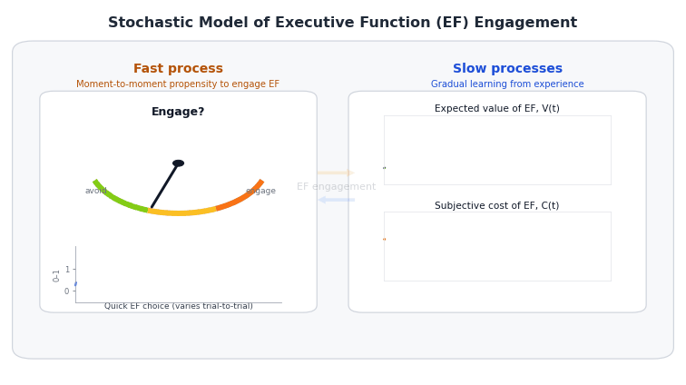

# Quick Intro

This document presents a stochastic differential equation (SDE) model of 
**executive function (EF) engagement**, based on the theory that children learn 
whether EF is *worth engaging* through experience.

> Core idea: children learn whether EF is worth engaging through experience, while EF capacity also grows gradually through maturation and practice.

The model separates:

- **Fast process (engagement):** moment-to-moment *propensity* to engage, $E(t)$
- **Slow processes (learning + development):** gradual learning of  
  - expected value of EF $V(t)$  
  - subjective cost of EF $C(t)$  
  - EF capacity $K(t)$ (monotone developmental state)

{width="100%" fig-align="center"}


The model is used to illustrate four qualitative behaviors:

1. Stable individual differences in engagement trajectories

2. Developmental improvements in capacity and typical engagement

3. Transient within-person fluctuations (e.g., stress)

4. Intervention timing effects (early vs. late reward changes)

---

# Model Overview


  
```{mermaid}
%%{init: {"theme":"base","themeVariables":{"fontFamily":"Inter, system-ui, Arial"}}}%%
flowchart LR

classDef fast fill:#E8F4FF,stroke:#1E6FB9,stroke-width:1.5px,color:#0B2A3D;
classDef slow fill:#FFF2CC,stroke:#B07D00,stroke-width:1.5px,color:#3D2B00;
classDef derived fill:#F3E8FF,stroke:#6B21A8,stroke-width:1.5px,color:#2E1065;
classDef utility fill:#E6FFFA,stroke:#0F766E,stroke-width:1.5px,color:#042F2E;
classDef param fill:#F3F4F6,stroke:#6B7280,stroke-width:1.2px,color:#111827,stroke-dasharray: 4 3;

linkStyle default stroke:#93A1AA,stroke-width:1.2px;

subgraph MAIN[" "]
direction LR

U{{Utility}}:::utility --> E(["E(t): EF engagement propensity"]):::fast

V(["V(t): learned value"]):::slow --> U
C(["C(t): subjective effort cost"]):::slow --> U
X[["extra_cost(t): stress/context"]]:::param --> U

E --> Rexp([Reward signal]):::derived
p[["p_reward(t) & reward_mag"]]:::param --> Rexp
Rexp -->|"updates expectations (+)"| V

M[[maturation]]:::param --> K(["K(t): capacity"]):::slow
E -->|"practice builds skill (+)"| K

%% --- Updated cost dynamics (mean reversion + capacity shift) ---
Cbase[["baseline cost level + mean-reversion rate"]]:::param --> C
K -->|"makes EF feel easier (—)"| C

end
style MAIN fill:transparent,stroke:transparent

subgraph LEGEND["How to read nodes"]
direction TB
L1(["FAST state (t)"]):::fast
L2(["SLOW state (t)"]):::slow
L3([Derived quantity]):::derived
L4[["Parameter / input"]]:::param
end
style LEGEND fill:#F8FAFC,stroke:#CBD5E1,stroke-width:1.2px,rx:8,ry:8


```  


## Fast Process: EF Engagement Propensity
  
At each moment $t$, the agent computes a **propensity** (interpretable as a probability or expected frequency) of engaging EF:
  
$$
  E(t) = \sigma\left(\frac{V(t) - \big(C(t) + \text{extra\_cost}(t)\big)}{\tau}\right),
\qquad \sigma(x) = \frac{1}{1+e^{-x}}.
$$

Define the *instantaneous control utility*:
$$
    U(t)=V(t)-\big(C(t)+\text{extra\_cost}(t)\big),
$$
so $E(t)=\sigma\big(U(t)/\tau\big)$.


Terms:
    
* $V(t)$: learned expected value of engaging EF
* $C(t)$: learned cost of engaging EF 
* $\text{extra\_cost}(t)$: temporary situational load (e.g., stress) that raises immediate cost
* $\tau$: decision temperature; larger $\tau$ makes the logistic mapping flatter, so engagement is ***less sensitive*** to value–cost differences $V(t)-[C(t)+\text{extra\_cost}(t)]$
* $\sigma(\cdot)$: logistic function mapping utility to $[0,1]$

  > When $V(t)$ exceeds $C(t)+\text{extra\_cost}(t)$, utility is positive and $E(t)$ moves toward 1; when costs dominate, $E(t)$ moves toward 0.
  
  
<!-- ### Capacity enters the decision through effective cost -->

<!-- EF capacity $K(t)$ reduces the experienced effort cost, so we define: -->

<!-- $$ -->
<!--   C_{\text{eff}}(t) = C(t) - \beta_K K(t), -->
<!-- $$ -->

<!-- where $\beta_K>0$ controls how strongly capacity makes EF feel easier to use. -->

<!-- * **$C(t)$** is the *subjective effort cost* of using EF right now (“this feels hard / effortful”). -->
<!-- * **$K(t)$** is *EF capacity/skill* (“how capable/efficient the child is at doing EF”). -->
<!-- * As capacity grows, the *same EF task feels less effortful* because the person can do it more efficiently. -->

<!-- So we say: -->

<!--   > “Your baseline effort cost is $C(t)$, but if you have higher capacity $K(t)$, the *effective* cost you experience is lower.” -->

<!-- That’s what $C_{\text{eff}}(t)$ is: the cost **after** accounting for capacity. -->


<!-- ::: {.callout-tip title="Why subtract?"} -->

<!-- If **capacity increases** $K(t)\uparrow$, then **effective cost decreases** $C_{\text{eff}}(t)\downarrow$. -->

<!-- That makes EF engagement more likely, because the decision utility uses $V - C_{\text{eff}}$. -->
<!-- So capacity acts like a “discount” on effort. -->
<!-- ::: -->


<!-- ::: {.callout-tip title="What does $\beta_K$ do?"} -->


<!-- $\beta_K>0$ is just a **scaling knob**: -->

<!-- * If $\beta_K$ is small, capacity barely changes experienced cost. -->
<!-- * If $\beta_K$ is large, capacity strongly reduces experienced cost. -->

<!-- You can describe it as: -->
<!-- $\beta_K$ controls how much skill translates into effort reduction. -->
<!-- ::: -->


<!-- "$C(t)$ is how effortful EF feels, and $K(t)$ is EF skill. -->
<!-- We model skill as reducing experienced effort, so the decision uses an effective cost $C_{\text{eff}}(t)=C(t)-\beta_KK(t)$, meaning ***higher capacity makes EF feel easier and therefore more likely to be engaged.***" -->


<!-- ::: {.callout-note title="One technical note " collapse="true" color="blue"} -->
<!-- This is a ***modeling choice***—one simple way to couple capacity into decisions.    -->
<!-- Another equivalent formulation would be to let capacity add to utility directly (e.g., $+ \beta_KK(t))$.   Subtracting it from cost is just cleaner conceptually: ***“capacity reduces effort.”*** -->
<!-- ::: -->

<!-- This separation is intentional: -->

<!-- * $E(t)$ can fluctuate rapidly (state-dependent engagement), -->
<!-- * $K(t)$ represents **slow developmental change** (capacity/skill), not momentary choice. -->


<!-- <br> -->


## Slow Processes: Learning and Development (SDE Dynamics)

### $K$: Capacity dynamics (slow EF development)
  
We represent EF capacity explicitly, with a bounded development state $K(t)\in[0,1]$:
  
$$
\frac{dK(t)}{dt}=\rho_{\text{mat}}\big(1-K(t)\big)+
\rho_{\text{prac}}E(t)\big(1-K(t)\big),
\qquad K(t)\in[0,1].
$$
  
* $\rho_{\text{mat}}$: basline maturational growth 
* $\rho_{\text{prac}}E(t)$: practice-driven growth (more engagement → faster capacity growth).
* $(1-K(t))$: saturation/headroom (growth slows as capacity approaches its ceiling).


::: {.callout-tip title="why (1−K)?"}
$(1−K)$ is the remaining headroom—without it, capacity would grow linearly without bound; with it, growth naturally slows near a ceiling, which matches saturating developmental improvement.”
:::


This gives a clean developmental interpretation:

* $K(t)$ is a *developmental* quantity $\rightarrow$ ***slow, monotone, saturating***,
* $E(t)$ is an *engagement* quantity $\rightarrow$ ***fast, fluctuating***,


---
  
### $V$: Value dynamics (learning “is EF worth it?”)

#### Expected reward signal (what value is learning toward)

When EF is engaged, it may yield reward. We summarize this with an ***expected rewared rate***:

$$
R^{\text{exp}}(t) \;=\; E(t)\cdot p_{\text{reward}}\cdot \text{reward\_mag}.
$$


- $E(t)\in[0,1]$: the model’s *propensity* (probability / expected frequency) of engaging EF at time $t$
- $p_{\text{reward}}\in[0,1]$: probability of receiving reward **conditional on engaging EF** $P(reward|EF engaged)$ --> captures *how rewarding the environment is* when EF is engaged (environmental payoff rate; can vary with context or interventions)
- $\text{reward\_mag}$: reward magnitude (and therefore the scale of $V$)

  

::: {.callout-tip title="Expected-reward approximation" collapse="true"}

In a fully discrete version of the model, two random events would occur at each step:

1. The child either engages EF or not:
   $$
   A(t)\sim\mathrm{Bernoulli}(E(t)).
   $$

2. If EF is engaged, reward is either received or not:
   $$
   Z(t)\sim\mathrm{Bernoulli}(p_{\text{reward}}).
   $$

The realized reward would be

$$
R(t)=A(t)Z(t)\text{reward\_mag},
$$

which is noisy because both engagement and reward are sampled.

In the present model, we do not sample these binary events directly. Instead, value learning is driven by the expected reward implied by the current engagement propensity:

$$
R^{\exp}(t)
=
\mathbb{E}[R(t)\mid E(t)]
=
E(t)p_{\text{reward}}\text{reward\_mag}.
$$

Thus, $E(t)$ can be read as the expected frequency or probability of engaging EF, and $R^{\exp}(t)$ is the average reward signal that value learning tracks.

:::


<br>

#### Value learning is a ***pull toward what is currently paying off***
$V(t)$ represents the child’s learned belief that “using EF is worth it.”  


Value learns toward this reward signal via a noisy error-correction process:

  
$$
  dV(t) = \alpha_V \big(R^{\text{exp}}(t) - V(t)\big)dt + \sigma_VdW_V(t).
$$

* The term $\big(R^{\text{exp}}(t) - V(t)\big)$ is a **prediction error**:
  
  * If $R^{\text{exp}}(t) > V(t)$: EF is paying off more than expected → $V(t)$ increases.
  * If $R^{\text{exp}}(t) < V(t)$: EF is paying off less than expected → $V(t)$ decreases.
  * $\alpha_V$ is the **learning rate**: it controls *how quickly* beliefs update.
  * $dt$ is just the size of the time step (in your simulations, $dt = 0.1$ weeks).

This is the continuous-time analogue of the standard reinforcement-learning update:
  $$
    V \leftarrow V + \alpha \cdot (\text{reward signal} - V).
  $$ 

* $\sigma_V dW_V(t)$: stochastic fluctuations in learning (Brownian noise) ***considered 0; unless you are interested in specific stochastic behavior of V or C, having $\tau$ is often enough to model randomness with EF engagement.***

---


### $C$: Cost dynamics (learning “how effortful EF feels”)

We treat subjective effort cost $C(t)$ as a slow state shaed by:

1. **A pull toward a baseline cost level** $C_{\text{set}}$ (mean reversion)
2. **Capacity** $K(t)$, which gradually makes EF feel easier (downward shift in cost)

$$
  dC(t)=\Big[\eta_C\big(C_{\text{set}}-C(t)\big)-\beta_K K(t)\Big]dt+\sigma_CdW_C(t).
$$

* $\eta_C>0$: mean reversion rate (how quickly perceived effort returns toward the baseline level $C_{\text{set}}$ absent capacity gains)
* $C_{\text{set}}$: baseline cost set point (trait-/context-like “default” effortfulness of EF)
* $\beta_K>0$: capacity-to-effort coupling (how strongly capacity reduces felt effort over time)
* $\sigma_C dW_C(t)$: stochastic fluctuations in perceived effort (momentary noise around the slow trend)

**Interpretation:** EF effort costs are not assumed to drift downward indefinitely. Instead, costs fluctuate around a baseline $C_{\text{set}}$, but increasing capacity $K(t)$ persistently pushes costs lower. This creates stable long-run differences in engagement: children who, through their payoff history, build higher capacity experience lower subjective costs, which sustains higher EF engagement.


This creates a reinforcing developmental loop:
$$
    E(t)\ \rightarrow\ K(t)\ \rightarrow\ C(t)\ \rightarrow\ E(t),
$$

where higher engagement builds capacity $(E \to K)$, higher capacity lowers cost $(K \to C)$, and lower cost makes future engagement more likely $(C \to E)$.


<!-- #### Intuition: three forces move cost over time -->

<!-- 1) **Maturation makes EF feel easier (baseline downward drift)**   -->
<!-- $$ -->
<!-- -\kappa_C -->
<!-- $$ -->
<!-- - If $\kappa_C>0$, cost tends to **decrease over development** even without practice. -->
<!-- - $\kappa_C$ represents an age-related, across-the-board maturation effect—separate from learning—so cost slowly decreases with development in a way that’s common across individuals. -->


<!-- 2) **Experience-dependent learning: practice vs avoidance** -->
<!-- $$ -->
<!-- \alpha_C\big[(1-E(t))\delta_{\uparrow} \;-\; E(t)\delta_{\downarrow}\big] -->
<!-- $$ -->

<!-- - $E(t)\in[0,1]$ is the *propensity* to engage EF right now. -->
<!-- - $(1-E(t))$ is the complementary propensity to *not* engage EF. -->

<!-- So the bracketed term is a **weighted average** of two learning pressures: -->

<!-- - **Avoidance-driven cost increase**: $(1-E(t))\delta_{\uparrow}$   -->
<!--   If $\delta_{\uparrow}>0$, then *not using EF* makes it feel **more costly later** (“avoidance makes it harder next time”). -->

<!-- - **Practice-driven cost decrease**: $-E(t)\delta_{\downarrow}$   -->
<!--   If $\delta_{\downarrow}>0$, then *using EF* reduces cost over time (“practice makes it easier”). -->

<!-- - $\alpha_C$ scales how quickly these experience effects accumulate. -->

<!-- 3) **Random fluctuations in perceived effort** -->
<!-- $$ -->
<!-- \sigma_C\,dW_C(t) -->
<!-- $$ -->
<!-- - stochastic fluctuations in cost (Brownian noise) -->
<!-- - In discrete simulation this becomes $\sigma_C\sqrt{dt}\cdot \mathcal{N}(0,1)$. -->


<!-- #### What this implies in plain language -->

<!-- - When $E(t)$ is high for a sustained period, the practice term dominates and $C(t)$ tends to **fall** (EF feels easier). -->
<!-- - When $E(t)$ is low for a sustained period, the practice benefit is missing, and if $\delta_{\uparrow}>0$ there is also a direct penalty that pushes $C(t)$ **up**. -->


<!-- ::: {.callout-tip title="Yuko's simplification: set $\delta_{\uparrow}=0$"} -->

<!-- *Not engaging EF does not actively increase future cost*; it only means you **miss practice**, so cost fails to decrease. In that case: -->
<!-- $$ -->
<!-- dC(t) \;=\; \big\{-\kappa_C \;-\; \alpha_C\,E(t)\delta_{\downarrow}\big\}\,dt \;+\;\sigma_C\,dW_C(t), -->
<!-- $$ -->

<!-- which is often easier to justify: costs fall with maturation and with practice, without assuming a separate “avoidance makes EF harder” mechanism. -->

<!-- * “Cost $C(t)$ is a slow ‘felt effort’ variable: maturation pushes it down, practice pushes it down proportional to (E(t)), and we typically set the avoidance penalty $\delta_\uparrow=0$ so non-use doesn’t make EF harder—people just miss the chance to get easier through practice. -->

<!-- ::: -->

---
  
## What the model can generate
  
Together, these coupled dynamics can produce:
  

* **Early divergence and stable individual differences**
Small between-child differences in payoff environment (e.g., $p_{\text{reward}}$) or initial conditions can push learning onto different trajectories in $V(t)$, which then propagate to engagement $E(t)$, and—through practice—into capacity growth $K(t)$ and effort cost $C(t)$.

<!-- * **Normative developmental improvement** -->
<!-- Developmental gains arise from (i) maturation ($\rho_{\text{mat}}$ increasing $K(t)$, and $\kappa_C$ reducing $C(t))$ and (ii) practice-dependent capacity growth ($E(t)\to K(t)$), which further lowers cost via the $K(t)\to C(t)$ link. -->

* **Normative developmental improvement with saturation**  
Developmental gains arise from bounded capacity growth: maturation and engagement-dependent practice increase $K(t)$, but growth slows as the remaining headroom $(1-K(t))$ shrinks. Higher $K(t)$ then lowers subjective effort through the $\beta_K K(t)$ term in the cost equation, making future engagement more likely.

* **Transient dips in engagement under stress**
A temporary increase in $\text{extra\_cost}(t)$ reduces momentary utility and produces short-run drops in $E(t)$. Because $E(t)$ also drives practice, stress can additionally slow the *rate* of capacity growth during the stress window.

* **Intervention effects (reward-only, Yuko-consistent)**
Interventions manipulate rewards via $p_{\text{reward}}(t)$, which changes the reward signal driving $V(t)$. This shifts engagement $E(t)$ and can indirectly alter longer-run development by changing practice-dependent capacity growth $K(t)$, which then feeds back onto effort cost $C(t)$.


<br>

---

# Simulation

## Set-up

### Time scale and units
  
  The model is simulated on a **weekly time axis** for interpretability. Dynamics are integrated with a small Euler–Maruyama step of $dt = 0.1$ week (about *0.7 days*).

Throughout:
  
* Parameters labeled “per week” (e.g., learning rates and maturational drifts) are defined in **weekly units** and then multiplied by `dt` inside the simulator.
* Noise terms use the standard diffusion scaling **$\sqrt{dt}$** (so `sigma_*` is interpretable as volatility per $\sqrt{\text{week}}$).
* We store time both as `t` in weeks (continuous) and `year = t / 52` for plotting.

```{r}
#| label: setup
#| echo: true
#| include: false


library(ggplot2)
library(dplyr)
library(tidyr)
library(zoo)
library(purrr)
library(furrr)
library(future)
```


```{r}
#| label: globals
#| echo: true

# ============================================================
# Global time base
#   - Time unit: weeks
#   - Horizon: 10 years = 520 weeks
#   - Integration: dt = 0.1 week (~0.7 days) via Euler–Maruyama
#   - T_total includes the initial point at t = 0
# ============================================================

weeks_per_year <- 52
years_total    <- 10
H_weeks        <- years_total * weeks_per_year   # 520 weeks
dt             <- 0.1                            # step size in weeks
T_total        <- round(H_weeks / dt) + 1        # 520/0.1 + 1 = 5201 points


# Convenience: convert between discrete index and continuous time
idx_to_week <- function(idx) (idx - 1) * dt
idx_to_year <- function(idx) idx_to_week(idx) / weeks_per_year

# ============================================================
# Default parameters (weekly scale)
# Model story: E (fast engagement) -> learns/practices -> K (capacity)
#              K (slow) -> reduces C (subjective cost) -> increases E
# ============================================================

tau_V_weeks <- 26   # value learning time constant (~6 months)

default_pars <- list(

  # ---- Time base ----
  T  = T_total,
  dt = dt,

  # ---- Initial states ----
  V0 = 0.1,   # expected value of engaging control
  C0 = 1.0,   # subjective cost of engaging control
  K0 = 0.0,   # capacity (slow developmental state; bounded 0..1)

  # ---- Slow value learning ----
  alpha_V = 1 / tau_V_weeks,  # per-week learning rate for V(t)

  # ---- Cost dynamics: mean reversion to a baseline set point ----
  eta_C = 0.03,   # speed of reversion (per week)
  C_set = 1.0,    # baseline cost set point (higher = more costly baseline)

  # ---- Fast decision policy ----
  tau = 0.5,

  # ---- Reward environment ----
  p_reward   = 0.7,
  reward_mag = 1,

  # ---- Noise ----
  sigma_V = 0.003,
  sigma_C = 0.008,

  # ---- Capacity ----
  beta_K     = 0.005,    # K lowers C (shifts cost downward)
  rho_mat    = 0.0016,
  rho_prac   = 0.0060,
  monotone_K = TRUE,

  # ---- Developmental timing ----
  # age0 is the age at model start.
  # The plasticity gate slows K growth after late adolescence,
  # while K itself remains monotone and bounded.
  age0 = 4,
  use_plasticity_gate = TRUE,
  plasticity_mid_age = 18,
  plasticity_width = 1.25
)


```


## SDE solving function (Euler–Maruyama)

We simulate a continuous-time stochastic developmental model with three latent states:
  
* **Fast engagement propensity** $E(t)$: a momentary probability of engaging EF, computed each step from current utility.
* **Value** $V(t)$: learned expected payoff of engaging EF (slow).
* **Cost** $C(t)$: subjective effort cost of engaging EF (slow).
* **Capacity** $K(t)$: a slow developmental state that grows via maturation and practice, and **reduces cost over time**.

**Mechanism:**
  $$
    E \rightarrow K \rightarrow C \rightarrow E
  $$

* Higher engagement $E(t)$ produces more practice, accelerating growth in $K(t)$.
* Higher capacity $K(t)$ lowers the cost state $C(t)$ through the drift term.
* Lower cost $C(t)$ increases engagement $E(t)$ through the decision rule.

**Environment and perturbations:**
  
* Reward probability can be *constant* (`p_reward`) or *time-varying* (`p_reward_vec`) to implement interventions.
* Acute stress (or other transient demand) can enter as an additive *decision-only* cost term `extra_cost_vec(t)`.

We use Euler–Maruyama for the stochastic updates of $V(t)$ and $C(t)$ (diffusion noise), while $K(t)$ is deterministic and bounded.

```{r}
#| label: simulate_ef_sde
#| echo: true

simulate_ef_sde <- function(
  # ---- Time base ----
  T  = default_pars$T,
  dt = default_pars$dt,

  # ---- Initial states ----
  V0 = default_pars$V0,
  C0 = default_pars$C0,
  K0 = default_pars$K0,

  # ---- Slow value learning ----
  alpha_V = default_pars$alpha_V,

  # ---- Cost dynamics (mean reversion + capacity shift) ----
  eta_C  = default_pars$eta_C,   # mean reversion speed toward C_set (per week)
  C_set  = default_pars$C_set,   # baseline cost set point
  beta_K = default_pars$beta_K,  # K shifts costs downward

  # ---- Capacity growth ----
  rho_mat    = default_pars$rho_mat,
  rho_prac   = default_pars$rho_prac,
  monotone_K = default_pars$monotone_K,

  # ---- Developmental timing ----
  age0 = default_pars$age0,
  use_plasticity_gate = default_pars$use_plasticity_gate,
  plasticity_mid_age = default_pars$plasticity_mid_age,
  plasticity_width = default_pars$plasticity_width,

  # ---- Fast decision policy ----
  tau = default_pars$tau,

  # ---- Reward environment ----
  p_reward     = default_pars$p_reward,
  p_reward_vec = NULL,                  # optional time-varying reward probability, length T
  reward_mag   = default_pars$reward_mag,

  # ---- Noise (diffusion scales; per sqrt(week)) ----
  sigma_V = default_pars$sigma_V,
  sigma_C = default_pars$sigma_C,

  # ---- State bounds ----
  V_min = 0,
  V_max = reward_mag,
  C_min = -2,
  C_max = 2,
  K_min = 0,
  K_max = 1,

  # ---- Exogenous, decision-only perturbation ----
  extra_cost_vec = NULL,

  seed = NULL
){

  # 0) Setup + checks
  if (!is.null(seed)) set.seed(seed)

  stopifnot(T >= 2, dt > 0)
  stopifnot(V_min < V_max, C_min < C_max, K_min < K_max)
  stopifnot(V0 >= V_min, V0 <= V_max,
            C0 >= C_min, C0 <= C_max,
            K0 >= K_min, K0 <= K_max)

  N <- T

  if (is.null(extra_cost_vec)) extra_cost_vec <- rep(0, N)
  stopifnot(length(extra_cost_vec) == N)

  if (!is.null(p_reward_vec)) {
    stopifnot(length(p_reward_vec) == N)
    stopifnot(all(p_reward_vec >= 0 & p_reward_vec <= 1))
  } else {
    stopifnot(p_reward >= 0, p_reward <= 1)
  }

  # 1) Allocate
  V <- numeric(N); C <- numeric(N); K <- numeric(N); E <- numeric(N)
  V[1] <- V0; C[1] <- C0; K[1] <- K0

  # 2) Euler–Maruyama
  for (i in 1:(N - 1)) {

    # Fast engagement propensity (decision rule)
    utility <- V[i] - (C[i] + extra_cost_vec[i])
    E[i] <- 1 / (1 + exp(-utility / tau))

    # Reward schedule (constant or time-varying)
    p_i <- if (is.null(p_reward_vec)) p_reward else p_reward_vec[i]

    # Expected reward rate
    R_exp <- E[i] * p_i * reward_mag

    # Slow drifts
    dV_det <- alpha_V * (R_exp - V[i])

    # Cost: mean reversion to baseline minus capacity-driven reduction
    dC_det <- eta_C * (C_set - C[i]) - (beta_K * K[i])

    # Developmental plasticity gate:
    # growth is strong earlier in development and slows after late adolescence.
    # K itself does not decline; only the growth rate is gated.
    age_i <- age0 + ((i - 1) * dt) / weeks_per_year

    plasticity_i <- if (isTRUE(use_plasticity_gate)) {
      1 / (1 + exp((age_i - plasticity_mid_age) / plasticity_width))
    } else {
      1
    }

    dK_det <- plasticity_i * (
      rho_mat * (1 - K[i]) +
        rho_prac * E[i] * (1 - K[i])
    )

    # Diffusion noise
    dV_sto <- sigma_V * sqrt(dt) * rnorm(1)
    dC_sto <- sigma_C * sqrt(dt) * rnorm(1)

    # Update
    V_next <- V[i] + dV_det * dt + dV_sto
    C_next <- C[i] + dC_det * dt + dC_sto
    K_next <- K[i] + dK_det * dt

    # Clamp
    V_next <- max(min(V_next, V_max), V_min)
    C_next <- max(min(C_next, C_max), C_min)
    K_next <- max(min(K_next, K_max), K_min)

    if (isTRUE(monotone_K)) K_next <- max(K[i], K_next)

    V[i + 1] <- V_next
    C[i + 1] <- C_next
    K[i + 1] <- K_next
  }

  # Final-step engagement
  utility_T <- V[N] - (C[N] + extra_cost_vec[N])
  E[N] <- 1 / (1 + exp(-utility_T / tau))

  t_seq <- seq(0, by = dt, length.out = N)
  age_seq <- age0 + t_seq / weeks_per_year

  plasticity_seq <- if (isTRUE(use_plasticity_gate)) {
    1 / (1 + exp((age_seq - plasticity_mid_age) / plasticity_width))
  } else {
    rep(1, N)
  }

  tibble(
    t = t_seq,
    year = t_seq / weeks_per_year,
    age = age_seq,
    plasticity = plasticity_seq,
    V = V,
    C = C,
    K = K,
    E = E
  )
}


```


---

## Figure 1A: Stable Individual Differences

***Goal***: illustrate how small **between-child differences in payoff** and **baseline subjective effort** can produce stable, long-run differences in EF engagement and developmental capacity.

Here we simulate 8 children who share the same learning rates, noise levels, and initial states $(V_0, C_0, K_0)$, but differ in two stable features:
  
* **Payoff probability** $p_{\text{reward}}$: how often engaging EF yields reward (an environmental/experience parameter that shapes value learning $V(t))$.
* **Baseline cost set point** $C_{\text{set}}$: a child-specific baseline for how effortful EF feels (a trait/context parameter that anchors the mean-reverting cost process).


```{r}
#| label: clean_result_helpers
#| echo: true

# ============================================================
# Clean result helpers
# ============================================================

clean_pars <- modifyList(default_pars, list(
  # Initial state: model starts in early childhood
  age0 = 4,
  V0 = 0.10,
  C0 = 1.00,
  K0 = 0.08,

  # Decision / learning scale
  tau = 0.45,
  reward_mag = 1.60,

  # Small noise; enough realism but not visually chaotic
  sigma_V = 0.0015,
  sigma_C = 0.0050,

  # Feedback loop strength
  eta_C = 0.020,
  beta_K = 0.010,

  # K depends strongly on engagement, not only maturation
  rho_mat = 0.0006,
  rho_prac = 0.0140,

  # Developmental window
  use_plasticity_gate = TRUE,
  plasticity_mid_age = 18,
  plasticity_width = 1.25
))


# ============================================================
# Sensitive-period parameter regimes
# Used only for stress/intervention timing figures.
# Purpose: make early developmental timing effects visible.
# ============================================================

sensitive_pars <- modifyList(clean_pars, list(
  V0 = 0.08,
  C0 = 1.05,
  K0 = 0.05,

  tau = 0.45,

  sigma_V = 0.001,
  sigma_C = 0.004,

  eta_C = 0.018,
  beta_K = 0.012,

  # Make K depend more on engagement/practice than maturation alone
  rho_mat  = 0.00010,
  rho_prac = 0.01000,

  # Sensitive period closes before/around late adolescence
  use_plasticity_gate = TRUE,
  plasticity_mid_age = 15.5,
  plasticity_width = 0.90
))

stress_pars <- modifyList(sensitive_pars, list(
  reward_mag = 2.00
))

reward_timing_pars <- modifyList(sensitive_pars, list(
  reward_mag = 2.80
))


smooth_weeks <- 26
smooth_steps <- round(smooth_weeks / dt)

add_behavior_measures <- function(df, seed = NULL) {
  if (!is.null(seed)) set.seed(seed + 9999)

  A <- rbinom(nrow(df), size = 1, prob = df$E)

  df %>%
    arrange(age) %>%
    mutate(
      E_smooth = zoo::rollmean(E, k = smooth_steps, fill = NA, align = "right"),
      E_smooth = ifelse(is.na(E_smooth), E, E_smooth),

      A = A,
      A_freq = zoo::rollmean(A, k = smooth_steps, fill = NA, align = "right"),
      A_freq = ifelse(is.na(A_freq), E, A_freq)
    )
}

run_reps <- function(condition, pars_override, R = 40, seed_base = 1000,
                     base_pars = clean_pars) {
  bind_rows(lapply(seq_len(R), function(r) {
    seed_r <- seed_base + r

    args <- modifyList(base_pars, pars_override)
    args$seed <- seed_r

    do.call(simulate_ef_sde, args) %>%
      add_behavior_measures(seed = seed_r) %>%
      mutate(
        condition = condition,
        rep = r
      )
  }))
}

summarize_reps_clean <- function(df, vars) {
  df %>%
    select(age, condition, rep, all_of(vars)) %>%
    pivot_longer(
      cols = all_of(vars),
      names_to = "var",
      values_to = "value"
    ) %>%
    group_by(condition, age, var) %>%
    summarize(
      mean = mean(value, na.rm = TRUE),
      lo = quantile(value, 0.10, na.rm = TRUE),
      hi = quantile(value, 0.90, na.rm = TRUE),
      .groups = "drop"
    )
}

theme_clean_result <- function(base_size = 15) {
  theme_minimal(base_size = base_size) +
    theme(
      legend.position = "bottom",
      strip.text = element_text(face = "bold"),
      panel.grid.minor = element_blank(),
      plot.title = element_text(face = "bold"),
      plot.subtitle = element_text(size = base_size - 2)
    )
}

make_smooth_window <- function(age, start_age, end_age, base, peak) {
  x <- rep(base, length(age))
  inside <- age >= start_age & age <= end_age

  phase <- (age[inside] - start_age) / (end_age - start_age)
  bump <- sin(pi * phase)^2

  x[inside] <- base + (peak - base) * bump
  x
}

```


#### What the panels show:
  
* $V(t)$ tracks the learned expected payoff of engaging EF and is higher when EF tends to pay off more often.
* $C(t)$ fluctuates around the baseline $C_{\text{set}}$ but is shifted downward over time by capacity $K(t)$.
* $E(t)$ is the fast, moment-to-moment probability of engaging EF, determined by the current utility $V(t) - C(t)$.
* $K(t)$ is a slow developmental state that grows through maturation and engagement-driven practice. In this parameter regime, children differ mainly in the rate at which they approach a shared developmental ceiling, rather than in indefinite long-run capacity growth.

**Mechanism:** $p_{\text{reward}}$ influences the value-of-control pathway $(V)$, while $C_{\text{set}}$ sets the baseline difficulty of engaging. Together they shape engagement $E(t)$, which drives practice-based growth in $K(t)$; rising $K(t)$ then reduces subjective costs $C(t)$, stabilizing individual differences over development.

---


```{r}
#| label: fig_clean_1_stable_differences
#| fig-width: 10
#| fig-height: 7
#| fig-align: "center"

# ============================================================
# Result 1: Stable individual differences
# ============================================================

years_stable <- 18
T_stable <- round(years_stable * weeks_per_year / dt) + 1

stable_conditions <- list(
  "Supportive context" = list(
    T = T_stable,
    p_reward = 0.82,
    C_set = 0.82
  ),
  "Average context" = list(
    T = T_stable,
    p_reward = 0.70,
    C_set = 0.98
  ),
  "Low-reward / high-effort context" = list(
    T = T_stable,
    p_reward = 0.56,
    C_set = 1.15
  )
)

df_stable <- bind_rows(lapply(names(stable_conditions), function(nm) {
  run_reps(
    condition = nm,
    pars_override = stable_conditions[[nm]],
    R = 50,
    seed_base = 2000 + match(nm, names(stable_conditions)) * 1000
  )
}))

df_stable_sum <- summarize_reps_clean(
  df_stable,
  vars = c("A_freq", "K")
) %>%
  mutate(
    var = factor(
      var,
      levels = c("A_freq", "K"),
      labels = c(
        "EF engagement frequency",
        "Capacity K(t)"
      )
    ),
    condition = factor(condition, levels = names(stable_conditions))
  )

ggplot(df_stable_sum, aes(age, mean, color = condition, fill = condition)) +
  geom_vline(xintercept = 18, linetype = "dashed", linewidth = 0.35) +
  geom_ribbon(aes(ymin = lo, ymax = hi), alpha = 0.12, color = NA) +
  geom_line(linewidth = 0.95) +
  facet_wrap(~ var, ncol = 1, scales = "free_y") +
  theme_clean_result() +
  labs(
    title = "Stable engagement differences emerge from payoff and effort context",
    subtitle = "The same developmental system can settle into different trajectories depending on reward and subjective effort",
    x = "Age",
    y = NULL,
    color = NULL,
    fill = NULL
  )

```


```{r}
#| label: fig_clean_2_typical_development
#| fig-width: 10
#| fig-height: 8
#| fig-align: "center"

# ============================================================
# Result 2: Developmental improvement
# ============================================================

years_dev <- 18
T_dev <- round(years_dev * weeks_per_year / dt) + 1

df_dev <- run_reps(
  condition = "Typical context",
  pars_override = list(
    T = T_dev,
    p_reward = 0.74,
    C_set = 0.95
  ),
  R = 60,
  seed_base = 5000
)

df_dev_sum <- summarize_reps_clean(
  df_dev,
  vars = c("K", "A_freq", "C")
) %>%
  mutate(
    var = factor(
      var,
      levels = c("K", "A_freq", "C"),
      labels = c(
        "Capacity K(t)",
        "EF engagement frequency",
        "Subjective effort cost C(t)"
      )
    )
  )

ggplot(df_dev_sum, aes(age, mean)) +
  geom_vline(xintercept = 18, linetype = "dashed", linewidth = 0.35) +
  geom_ribbon(aes(ymin = lo, ymax = hi), alpha = 0.16, color = NA) +
  geom_line(linewidth = 0.95) +
  facet_wrap(~ var, ncol = 1, scales = "free_y") +
  theme_clean_result() +
  labs(
    title = "Typical development: capacity rises, effort falls, engagement increases",
    subtitle = "Growth is strongest while developmental plasticity is high and slows after late adolescence",
    x = "Age",
    y = NULL
  )
```

  
  
  
```{r}  
#| label: fig_clean_3_early_stress
#| fig-width: 10
#| fig-height: 8
#| fig-align: "center"

# ============================================================
# Result 3: Early stress
# Stress occurs during the high-plasticity developmental window.
# It suppresses engagement and therefore slows capacity growth.
# ============================================================

years_stress <- 18
T_stress <- round(years_stress * weeks_per_year / dt) + 1

age_vec_stress <- stress_pars$age0 + seq(0, by = dt, length.out = T_stress) / weeks_per_year

extra_cost_none <- rep(0, T_stress)

# Stronger, longer early stress episode
extra_cost_early <- make_smooth_window(
  age = age_vec_stress,
  start_age = 7,
  end_age = 12,
  base = 0,
  peak = 1.60
)

df_stress <- bind_rows(
  run_reps(
    condition = "No stress",
    pars_override = list(
      T = T_stress,
      p_reward = 0.65,
      C_set = 1.00,
      extra_cost_vec = extra_cost_none
    ),
    R = 60,
    seed_base = 7000,
    base_pars = stress_pars
  ),
  run_reps(
    condition = "Early stress",
    pars_override = list(
      T = T_stress,
      p_reward = 0.65,
      C_set = 1.00,
      extra_cost_vec = extra_cost_early
    ),
    R = 60,
    seed_base = 7000,
    base_pars = stress_pars
  )
)

df_stress_sum <- summarize_reps_clean(
  df_stress,
  vars = c("A_freq", "K")
) %>%
  mutate(
    var = factor(
      var,
      levels = c("A_freq", "K"),
      labels = c(
        "EF engagement frequency",
        "Capacity K(t)"
      )
    )
  )

df_stress_input <- tibble(
  age = rep(age_vec_stress, 2),
  condition = rep(c("No stress", "Early stress"), each = T_stress),
  mean = c(extra_cost_none, extra_cost_early),
  lo = mean,
  hi = mean,
  var = factor(
    "Stress input: extra decision cost",
    levels = c(
      "Stress input: extra decision cost",
      "EF engagement frequency",
      "Capacity K(t)"
    )
  )
)

df_stress_plot <- bind_rows(
  df_stress_input,
  df_stress_sum %>%
    mutate(
      var = factor(
        as.character(var),
        levels = c(
          "Stress input: extra decision cost",
          "EF engagement frequency",
          "Capacity K(t)"
        )
      )
    )
) %>%
  mutate(
    condition = factor(condition, levels = c("No stress", "Early stress"))
  )

stress_shade <- tibble(
  xmin = 7,
  xmax = 12,
  ymin = -Inf,
  ymax = Inf
)

ggplot(df_stress_plot, aes(age, mean, color = condition, fill = condition)) +
  geom_rect(
    data = stress_shade,
    aes(xmin = xmin, xmax = xmax, ymin = ymin, ymax = ymax),
    inherit.aes = FALSE,
    alpha = 0.08,
    color = NA
  ) +
  geom_vline(xintercept = 18, linetype = "dashed", linewidth = 0.35) +
  geom_ribbon(aes(ymin = lo, ymax = hi), alpha = 0.12, color = NA) +
  geom_line(linewidth = 0.95) +
  facet_wrap(~ var, ncol = 1, scales = "free_y") +
  theme_clean_result() +
  labs(
    title = "Early stress can leave a persistent capacity lag",
    subtitle = "Stress suppresses engagement during a high-plasticity window, slowing later capacity development",
    x = "Age",
    y = NULL,
    color = NULL,
    fill = NULL
  )

```  


  
```{r}  
#| label: fig_clean_4_reward_timing
#| fig-width: 10
#| fig-height: 8
#| fig-align: "center"

# ============================================================
# Result 4: Reward timing
# Early reward support vs late reward support.
# Early support happens while K is still plastic.
# Late support happens after plasticity has mostly closed.
# ============================================================

years_reward <- 20
T_reward <- round(years_reward * weeks_per_year / dt) + 1

age_vec_reward <- reward_timing_pars$age0 + seq(0, by = dt, length.out = T_reward) / weeks_per_year

# Low baseline reward: without support, development is sluggish
p_base <- 0.35

p_none <- rep(p_base, T_reward)

# Early reward support: long enough to bootstrap value/engagement/practice
p_early <- make_smooth_window(
  age = age_vec_reward,
  start_age = 4.5,
  end_age = 12,
  base = p_base,
  peak = 0.98
)

# Late reward support: boosts engagement, but occurs after the main plastic window
p_late <- make_smooth_window(
  age = age_vec_reward,
  start_age = 18,
  end_age = 22,
  base = p_base,
  peak = 0.98
)

df_reward <- bind_rows(
  run_reps(
    condition = "No reward support",
    pars_override = list(
      T = T_reward,
      p_reward = p_base,
      p_reward_vec = p_none,
      C_set = 1.10
    ),
    R = 60,
    seed_base = 9000,
    base_pars = reward_timing_pars
  ),
  run_reps(
    condition = "Early reward support",
    pars_override = list(
      T = T_reward,
      p_reward = p_base,
      p_reward_vec = p_early,
      C_set = 1.10
    ),
    R = 60,
    seed_base = 9000,
    base_pars = reward_timing_pars
  ),
  run_reps(
    condition = "Late reward support",
    pars_override = list(
      T = T_reward,
      p_reward = p_base,
      p_reward_vec = p_late,
      C_set = 1.10
    ),
    R = 60,
    seed_base = 9000,
    base_pars = reward_timing_pars
  )
)

df_reward_sum <- summarize_reps_clean(
  df_reward,
  vars = c("A_freq", "K")
) %>%
  mutate(
    var = factor(
      var,
      levels = c("A_freq", "K"),
      labels = c(
        "EF engagement frequency",
        "Capacity K(t)"
      )
    )
  )

df_reward_input <- tibble(
  age = rep(age_vec_reward, 3),
  condition = rep(
    c("No reward support", "Early reward support", "Late reward support"),
    each = T_reward
  ),
  mean = c(p_none, p_early, p_late),
  lo = mean,
  hi = mean,
  var = factor(
    "Reward probability p_reward(t)",
    levels = c(
      "Reward probability p_reward(t)",
      "EF engagement frequency",
      "Capacity K(t)"
    )
  )
)

df_reward_plot <- bind_rows(
  df_reward_input,
  df_reward_sum %>%
    mutate(
      var = factor(
        as.character(var),
        levels = c(
          "Reward probability p_reward(t)",
          "EF engagement frequency",
          "Capacity K(t)"
        )
      )
    )
) %>%
  mutate(
    condition = factor(
      condition,
      levels = c(
        "No reward support",
        "Early reward support",
        "Late reward support"
      )
    )
  )

reward_shade <- tibble(
  xmin = c(4.5, 18),
  xmax = c(12, 22),
  ymin = -Inf,
  ymax = Inf
)

ggplot(df_reward_plot, aes(age, mean, color = condition, fill = condition)) +
  geom_rect(
    data = reward_shade,
    aes(xmin = xmin, xmax = xmax, ymin = ymin, ymax = ymax),
    inherit.aes = FALSE,
    alpha = 0.06,
    color = NA
  ) +
  geom_vline(xintercept = 18, linetype = "dashed", linewidth = 0.35) +
  geom_ribbon(aes(ymin = lo, ymax = hi), alpha = 0.12, color = NA) +
  geom_line(linewidth = 0.95) +
  facet_wrap(~ var, ncol = 1, scales = "free_y") +
  theme_clean_result() +
  labs(
    title = "Early reward support can shift later developmental trajectories",
    subtitle = "Early support boosts engagement while capacity is plastic; late support mainly affects engagement, with less room to change K",
    x = "Age",
    y = NULL,
    color = NULL,
    fill = NULL
  )
```  
  
  