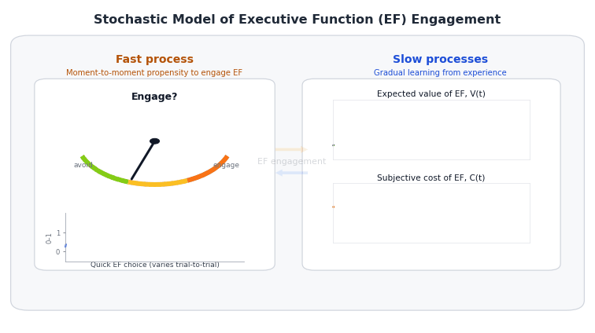

# Quick Intro

This document presents a stochastic differential equation (SDE) model of **executive function (EF) engagement**, based on the idea that children learn whether EF is *worth engaging* through experience.

> Core idea: children learn whether EF is worth engaging through experience, while EF capacity also grows gradually through maturation and practice.

The model separates:

- **Fast process:** moment-to-moment propensity to engage EF, $E(t)$
- **Slow processes:** gradual learning and development of
  - expected value of EF, $V(t)$
  - subjective effort cost of EF, $C(t)$
  - EF capacity, $K(t)$

{width="100%" fig-align="center"}

The simulations illustrate four qualitative behaviors:

1. **Typical development**: value, cost, engagement, and capacity co-evolve over development.
2. **Stable individual differences**: heterogeneous reward and effort contexts generate diverging trajectories.
3. **Early stress exposure**: stress can suppress engagement during a high-growth developmental window and leave later capacity differences.
4. **Reward timing**: reward support has larger later consequences when it occurs earlier in development.

---

# Model Overview

```{mermaid}
%%{init: {"theme":"base","themeVariables":{"fontFamily":"Inter, system-ui, Arial"}}}%%
flowchart LR

classDef fast fill:#E8F4FF,stroke:#1E6FB9,stroke-width:1.5px,color:#0B2A3D;
classDef slow fill:#FFF2CC,stroke:#B07D00,stroke-width:1.5px,color:#3D2B00;
classDef derived fill:#F3E8FF,stroke:#6B21A8,stroke-width:1.5px,color:#2E1065;
classDef utility fill:#E6FFFA,stroke:#0F766E,stroke-width:1.5px,color:#042F2E;
classDef param fill:#F3F4F6,stroke:#6B7280,stroke-width:1.2px,color:#111827,stroke-dasharray: 4 3;

linkStyle default stroke:#93A1AA,stroke-width:1.2px;

subgraph MAIN[" "]
direction LR

U{{Utility}}:::utility --> E(["E(t): EF engagement propensity"]):::fast

V(["V(t): learned value"]):::slow --> U
C(["C(t): subjective effort cost"]):::slow --> U
X[["extra_cost(t): stress/context"]]:::param --> U

E --> Rexp([Reward signal]):::derived
p[["p_reward(t) & reward_mag"]]:::param --> Rexp
Rexp -->|"updates expectations (+)"| V

M[["maturation"]]:::param --> K(["K(t): capacity"]):::slow
G[["g(age): developmental growth opportunity"]]:::param --> K
E -->|"practice builds skill (+)"| K

Cbase[["baseline cost level + mean reversion"]]:::param --> C
K -->|"makes EF feel easier (−)"| C

end
style MAIN fill:transparent,stroke:transparent

subgraph LEGEND["How to read nodes"]
direction TB
L1(["FAST state (t)"]):::fast
L2(["SLOW state (t)"]):::slow
L3([Derived quantity]):::derived
L4[["Parameter / input"]]:::param
end
style LEGEND fill:#F8FAFC,stroke:#CBD5E1,stroke-width:1.2px,rx:8,ry:8
```

## Fast Process: EF Engagement Propensity

At each moment $t$, the agent computes a propensity of engaging EF:

$$
E(t)=\sigma\left(\frac{V(t)-[C(t)+\text{extra\_cost}(t)]}{\tau}\right),
\qquad
\sigma(x)=\frac{1}{1+e^{-x}}.
$$

Define instantaneous control utility:

$$
U(t)=V(t)-[C(t)+\text{extra\_cost}(t)].
$$

Then:

$$
E(t)=\sigma(U(t)/\tau).
$$

Terms:

- $V(t)$: learned expected value of engaging EF
- $C(t)$: learned subjective effort cost
- $\text{extra\_cost}(t)$: temporary situational load, such as stress
- $\tau$: decision temperature; larger $\tau$ makes engagement less sensitive to value--cost differences
- $\sigma(\cdot)$: logistic function mapping utility to $[0,1]$

When $V(t)$ exceeds $C(t)+\text{extra\_cost}(t)$, utility is positive and engagement moves toward 1. When costs dominate, engagement moves toward 0.

## Slow Processes: Learning and Development

### Capacity dynamics: $K(t)$

Capacity is represented as a bounded developmental state, $K(t)\in[0,1]$:

$$
\frac{dK(t)}{dt}
=
g(a)
\left[\rho_{\text{mat}}+\rho_{\text{prac}}E(t)\right]
\left(1-K(t)\right),
$$

where $a$ denotes age.

The term $g(a)$ is an **age-dependent developmental growth-opportunity function**. It is high earlier in development and lower later. It does not directly change capacity or engagement; it scales how strongly maturation and engagement-driven practice can increase capacity at that age.

For implementation, I use a smooth **decreasing** curve:

$$
g(a)=\frac{1}{1+\exp\left((a-a_{\text{mid}})/2.5\right)}.
$$

The point is not that this exact curve is a biological law. It is a simple way to say that growth opportunity is high earlier in development and gradually lower later. I use a smooth curve instead of a hard cutoff because a hard cutoff would imply that developmental growth suddenly stops at one exact age. In the simulations below, the transition width is fixed at 2.5 years, so the only timing feature I interpret is $a_{\text{mid}}$, the age where growth opportunity is halfway reduced.

- $a$: age
- $a_{\text{mid}}$: age where growth opportunity is halfway reduced, so $g(a)=0.5$
- $\rho_{\text{mat}}$: maturational growth
- $\rho_{\text{prac}}E(t)$: practice-driven growth
- $1-K(t)$: remaining developmental headroom
- $g(a)$: age-dependent growth opportunity


::: {.callout-note}
## Note on `transition_width`

When we describe developmental change with an age-dependent logistic function, the transition can be written in either increasing or decreasing form depending on what the term represents.

For an **increasing developmental capacity** term:

$$
s(a) = \frac{1}{1 + \exp\left(-\frac{a - a_{\text{mid}}}{w}\right)}
$$

For a **decreasing immaturity or vulnerability** term:

$$
g(a) = \frac{1}{1 + \exp\left(\frac{a - a_{\text{mid}}}{w}\right)}
$$

In both cases:

- $a$ is age;
- $a_{\text{mid}}$ is the midpoint age of the transition;
- $w$ is the **transition width**.

The transition width is not exactly the slope. It is an **inverse-slope** or **smoothness** parameter: larger values of $w$ make the transition more gradual, while smaller values make it sharper.

For the decreasing form above, the derivative is:

$$
\frac{dg(a)}{da} = -\frac{1}{w}g(a)(1-g(a)).
$$

The slope is steepest at the midpoint, where $g(a)=0.5$. Therefore:

$$
\left.\frac{dg(a)}{da}\right|_{a=a_{\text{mid}}}
= -\frac{1}{4w}.
$$

So if we fix:

$$
w = 2.5,
$$

then the maximum slope is:

$$
-\frac{1}{4 \times 2.5} = -0.10.
$$

That means the function changes by about **0.10 per year at the midpoint**. A useful rule is that moving $w$ years below or above the midpoint moves the function from about 0.73 to 0.27 in the decreasing case:

$$
g(a_{\text{mid}} - w) \approx 0.73,
\qquad
g(a_{\text{mid}} + w) \approx 0.27.
$$

So `transition_width = 2.5` means that the developmental change is **smoothly spread across several years**, rather than treated as a sharp cutoff at one age.
:::


::: {.callout-note title="Why K(t) does not necessarily reach 1"}

The value $K=1$ is a theoretical upper bound, not a level that every simulated child must reach.

If we define

$$
r(t)=g(a(t))[\rho_{\text{mat}}+\rho_{\text{prac}}E(t)],
$$

then

$$
\frac{dK}{dt}=r(t)(1-K).
$$

The solution is

$$
K(t)=1-(1-K_0)\exp\left[-\int_0^t r(s)ds\right].
$$

So later capacity depends on the accumulated growth opportunity

$$
\int_0^t g(a(s))[\rho_{\text{mat}}+\rho_{\text{prac}}E(s)]ds.
$$

If $g(a)$ stayed high forever, this accumulated opportunity would keep growing and $K(t)$ would eventually approach 1. But because $g(a)$ becomes small later in development, total growth opportunity is limited. Therefore, different early engagement histories can lead to different effective adult plateaus.

:::

This keeps the capacity state monotone and bounded, but allows early engagement history to have persistent consequences. If engagement is low while $g(a)$ is high, the system accumulates less capacity growth. Later, when $g(a)$ is low, the system has less opportunity to catch up.

### Value dynamics: $V(t)$

When EF is engaged, it may yield reward. We summarize the expected reward signal as:

$$
R^{\text{exp}}(t)=E(t)\cdot p_{\text{reward}}(t)\cdot \text{reward\_mag}.
$$

Value learns toward this reward signal:

$$
dV(t)=\alpha_V\left(R^{\text{exp}}(t)-V(t)\right)dt+\sigma_VdW_V(t).
$$

Thus, $V(t)$ increases when EF is paying off more than expected and decreases when EF is paying off less than expected.

### Cost dynamics: $C(t)$

Subjective effort cost follows a mean-reverting process, shifted downward by capacity:

$$
dC(t)=\left[\eta_C(C_{\text{set}}-C(t))-\beta_KK(t)\right]dt+\sigma_CdW_C(t).
$$

- $C_{\text{set}}$: baseline effort cost level
- $\eta_C$: mean reversion rate
- $\beta_K$: strength with which capacity lowers subjective cost

This creates the reinforcing loop:

$$
E(t)\rightarrow K(t)\rightarrow C(t)\rightarrow E(t).
$$

Higher engagement builds capacity. Higher capacity lowers subjective cost. Lower cost makes future engagement more likely.

## What the model can generate

Together, these dynamics can generate:

- **Typical developmental improvement**: value, cost, engagement, and capacity co-evolve.
- **Stable individual differences**: heterogeneous reward and effort contexts can produce diverging developmental trajectories.
- **Persistent consequences of early stress exposure**: stress suppresses engagement during a high-growth period, reducing accumulated capacity growth.
- **Timing effects of reward support**: early support has larger effects on later capacity than late support because it occurs when $g(a)$ is high.

---

# Simulation

## Set-up

The model is simulated on a weekly time axis. We use an Euler--Maruyama step of $dt=0.1$ week, approximately 0.7 days. Parameters labeled per week are multiplied by `dt` inside the simulator. Noise terms use the standard diffusion scaling $\sqrt{dt}$.

```{r}
#| label: setup
#| echo: true
#| include: false

library(ggplot2)
library(dplyr)
library(tidyr)
library(zoo)
library(purrr)
```

```{r}
#| label: globals
#| echo: true

weeks_per_year <- 52
dt <- 0.1

# Smooth developmental growth-opportunity function.
# The width is fixed for presentation clarity; only the midpoint is interpreted.
age_growth_multiplier <- function(age, mid_age = 16.5) {
  width_fixed <- 2.5
  1 / (1 + exp((age - mid_age) / width_fixed))
}

# Default model parameters.
default_pars <- list(
  T  = round(20 * weeks_per_year / dt) + 1,
  dt = dt,

  # Initial states
  age0 = 4,
  V0 = 0.10,
  C0 = 1.05,
  K0 = 0.05,

  # Learning and cost dynamics
  alpha_V = 1 / 26,
  eta_C = 0.018,
  C_set = 1.00,
  beta_K = 0.012,

  # Capacity growth
  rho_mat = 0.00008,
  rho_prac = 0.00650,
  monotone_K = TRUE,
  use_growth_gate = TRUE,
  growth_mid_age = 16.5,

  # Decision and reward environment
  tau = 0.45,
  p_reward = 0.70,
  reward_mag = 2.00,

  # Noise
  sigma_V = 0.0015,
  sigma_C = 0.0050
)
```

```{r}
#| label: fig_growth_opportunity_function
#| fig-width: 7.5
#| fig-height: 4.5
#| fig-align: "center"
#| echo: true

growth_df <- tibble(
  age = seq(4, 30, length.out = 400),
  growth_opportunity = age_growth_multiplier(age, mid_age = default_pars$growth_mid_age)
)

ggplot(growth_df, aes(age, growth_opportunity)) +
  geom_line(color = "#264653", linewidth = 1.15) +
  geom_vline(
    xintercept = default_pars$growth_mid_age,
    linetype = "dashed",
    color = "#6B7280",
    linewidth = 0.4
  ) +
  annotate(
    "text",
    x = default_pars$growth_mid_age + 1.8,
    y = 0.55,
    label = "growth opportunity halfway reduced",
    size = 3.7,
    color = "#374151"
  ) +
  coord_cartesian(ylim = c(0, 1)) +
  theme_minimal(base_size = 14) +
  theme(panel.grid.minor = element_blank()) +
  labs(
    title = "Age-dependent developmental growth opportunity",
    subtitle = "The exact curve is not interpreted literally; it gives a smooth transition from high to lower growth opportunity",
    x = "Age",
    y = "g(age)"
  )
```

## SDE solving function

```{r}
#| label: simulate_ef_sde
#| echo: true

simulate_ef_sde <- function(
  T  = default_pars$T,
  dt = default_pars$dt,

  age0 = default_pars$age0,
  V0 = default_pars$V0,
  C0 = default_pars$C0,
  K0 = default_pars$K0,

  alpha_V = default_pars$alpha_V,
  eta_C = default_pars$eta_C,
  C_set = default_pars$C_set,
  beta_K = default_pars$beta_K,

  rho_mat = default_pars$rho_mat,
  rho_prac = default_pars$rho_prac,
  monotone_K = default_pars$monotone_K,
  use_growth_gate = default_pars$use_growth_gate,
  growth_mid_age = default_pars$growth_mid_age,

  tau = default_pars$tau,
  p_reward = default_pars$p_reward,
  p_reward_vec = NULL,
  reward_mag = default_pars$reward_mag,

  sigma_V = default_pars$sigma_V,
  sigma_C = default_pars$sigma_C,

  V_min = 0,
  V_max = reward_mag,
  C_min = -2,
  C_max = 2,
  K_min = 0,
  K_max = 1,

  extra_cost_vec = NULL,
  seed = NULL
) {

  if (!is.null(seed)) set.seed(seed)

  stopifnot(T >= 2, dt > 0)
  stopifnot(V_min < V_max, C_min < C_max, K_min < K_max)
  stopifnot(V0 >= V_min, V0 <= V_max)
  stopifnot(C0 >= C_min, C0 <= C_max)
  stopifnot(K0 >= K_min, K0 <= K_max)

  N <- T

  if (is.null(extra_cost_vec)) extra_cost_vec <- rep(0, N)
  stopifnot(length(extra_cost_vec) == N)

  if (!is.null(p_reward_vec)) {
    stopifnot(length(p_reward_vec) == N)
    stopifnot(all(p_reward_vec >= 0 & p_reward_vec <= 1))
  } else {
    stopifnot(p_reward >= 0, p_reward <= 1)
  }

  V <- numeric(N)
  C <- numeric(N)
  K <- numeric(N)
  E <- numeric(N)
  p_used <- numeric(N)

  V[1] <- V0
  C[1] <- C0
  K[1] <- K0

  for (i in 1:(N - 1)) {

    age_i <- age0 + ((i - 1) * dt) / weeks_per_year
    growth_i <- if (isTRUE(use_growth_gate)) {
      age_growth_multiplier(age_i, mid_age = growth_mid_age)
    } else {
      1
    }

    utility <- V[i] - (C[i] + extra_cost_vec[i])
    E[i] <- 1 / (1 + exp(-utility / tau))

    p_i <- if (is.null(p_reward_vec)) p_reward else p_reward_vec[i]
    p_used[i] <- p_i

    R_exp <- E[i] * p_i * reward_mag

    dV_det <- alpha_V * (R_exp - V[i])
    dC_det <- eta_C * (C_set - C[i]) - beta_K * K[i]
    dK_det <- growth_i * (rho_mat + rho_prac * E[i]) * (1 - K[i])

    V_next <- V[i] + dV_det * dt + sigma_V * sqrt(dt) * rnorm(1)
    C_next <- C[i] + dC_det * dt + sigma_C * sqrt(dt) * rnorm(1)
    K_next <- K[i] + dK_det * dt

    V_next <- max(min(V_next, V_max), V_min)
    C_next <- max(min(C_next, C_max), C_min)
    K_next <- max(min(K_next, K_max), K_min)

    if (isTRUE(monotone_K)) K_next <- max(K[i], K_next)

    V[i + 1] <- V_next
    C[i + 1] <- C_next
    K[i + 1] <- K_next
  }

  utility_T <- V[N] - (C[N] + extra_cost_vec[N])
  E[N] <- 1 / (1 + exp(-utility_T / tau))
  p_used[N] <- if (is.null(p_reward_vec)) p_reward else p_reward_vec[N]

  t_seq <- seq(0, by = dt, length.out = N)
  age_seq <- age0 + t_seq / weeks_per_year
  growth_seq <- if (isTRUE(use_growth_gate)) {
    age_growth_multiplier(age_seq, mid_age = growth_mid_age)
  } else {
    rep(1, N)
  }

  effective_cost <- C + extra_cost_vec
  decision_utility <- V - effective_cost
  expected_reward <- E * p_used * reward_mag

  tibble(
    t = t_seq,
    year = t_seq / weeks_per_year,
    age = age_seq,
    growth_opportunity = growth_seq,
    p_reward_used = p_used,
    extra_cost = extra_cost_vec,
    effective_cost = effective_cost,
    decision_utility = decision_utility,
    expected_reward = expected_reward,
    V = V,
    C = C,
    K = K,
    E = E
  )
}
```

## Result helpers

```{r}
#| label: result_helpers
#| echo: true

smooth_weeks <- 26
smooth_steps <- round(smooth_weeks / dt)

clip01 <- function(x) pmin(pmax(x, 0), 1)

add_behavior_measures <- function(df, seed = NULL) {
  if (!is.null(seed)) set.seed(seed + 9999)

  A <- rbinom(nrow(df), size = 1, prob = df$E)

  df %>%
    arrange(age) %>%
    mutate(
      A = A,
      E_smooth = zoo::rollmean(E, k = smooth_steps, fill = NA, align = "right"),
      E_smooth = ifelse(is.na(E_smooth), E, E_smooth),
      A_freq = zoo::rollmean(A, k = smooth_steps, fill = NA, align = "right"),
      A_freq = ifelse(is.na(A_freq), E, A_freq)
    )
}

run_reps <- function(condition, pars_override, R = 50, seed_base = 1000,
                     base_pars = default_pars) {
  bind_rows(lapply(seq_len(R), function(r) {
    seed_r <- seed_base + r
    args <- modifyList(base_pars, pars_override)
    args$seed <- seed_r

    do.call(simulate_ef_sde, args) %>%
      add_behavior_measures(seed = seed_r) %>%
      mutate(
        condition = condition,
        rep = r
      )
  }))
}

summarize_reps <- function(df, vars) {
  df %>%
    select(age, condition, rep, all_of(vars)) %>%
    pivot_longer(
      cols = all_of(vars),
      names_to = "var",
      values_to = "value"
    ) %>%
    group_by(condition, age, var) %>%
    summarize(
      mean = mean(value, na.rm = TRUE),
      lo = quantile(value, 0.10, na.rm = TRUE),
      hi = quantile(value, 0.90, na.rm = TRUE),
      .groups = "drop"
    )
}

make_smooth_window <- function(age, start_age, end_age, base, peak) {
  x <- rep(base, length(age))
  inside <- age >= start_age & age <= end_age

  if (any(inside)) {
    phase <- (age[inside] - start_age) / (end_age - start_age)
    bump <- sin(pi * phase)^2
    x[inside] <- base + (peak - base) * bump
  }

  x
}

# Custom palettes for figures.
# These avoid ggplot's default colors and keep the slide figures consistent.
dev_cols <- list(
  individual = "#9AA6B2",
  median = "#111827"
)

hetero_cols <- c(
  "Lower later K" = "#B56576",
  "Middle later K" = "#6A994E",
  "Higher later K" = "#4E79A7"
)

stress_cols <- c(
  "No stress" = "#4D4D4D",
  "Early stress, ages 7-11" = "#C44E52",
  "Later stress, ages 17-21" = "#4C78A8"
)

reward_cols <- c(
  "No reward support" = "#4D4D4D",
  "Early support family" = "#2A9D8F",
  "Later support family" = "#E76F51"
)

theme_result <- function(base_size = 15) {
  theme_minimal(base_size = base_size) +
    theme(
      legend.position = "bottom",
      strip.text = element_text(face = "bold"),
      panel.grid.minor = element_blank(),
      plot.title = element_text(face = "bold"),
      plot.subtitle = element_text(size = base_size - 2)
    )
}
```

---

# Results

## Result 1: Typical developmental trajectory

First, we show the baseline developmental dynamics. This figure is meant to orient the reader to how the core states move together: learned value, subjective cost, engagement frequency, and capacity.

```{r}
#| label: fig_01_typical_development
#| fig-width: 10
#| fig-height: 9
#| fig-align: "center"

T_dev <- round(20 * weeks_per_year / dt) + 1

df_dev <- run_reps(
  condition = "Typical context",
  pars_override = list(
    T = T_dev,
    p_reward = 0.72,
    C_set = 1.00
  ),
  R = 80,
  seed_base = 5000
)

df_dev_lines <- df_dev %>%
  select(age, rep, V, C, A_freq, K) %>%
  pivot_longer(
    cols = c(V, C, A_freq, K),
    names_to = "var",
    values_to = "value"
  ) %>%
  mutate(
    var = factor(
      var,
      levels = c("V", "C", "A_freq", "K"),
      labels = c(
        "Learned value V(t)",
        "Subjective effort cost C(t)",
        "EF engagement frequency",
        "Capacity K(t)"
      )
    )
  )

df_dev_median <- df_dev_lines %>%
  group_by(age, var) %>%
  summarize(
    median = median(value, na.rm = TRUE),
    .groups = "drop"
  )

ggplot() +
  geom_line(
    data = df_dev_lines,
    aes(age, value, group = rep),
    color = dev_cols$individual,
    alpha = 0.20,
    linewidth = 0.30
  ) +
  geom_line(
    data = df_dev_median,
    aes(age, median),
    color = dev_cols$median,
    linewidth = 0.
  ) +
  geom_vline(
    xintercept = default_pars$growth_mid_age,
    linetype = "dashed",
    color = "#6B7280",
    linewidth = 0.35
  ) +
  facet_wrap(~ var, ncol = 1, scales = "free_y") +
  theme_result() +
  labs(
    title = "Typical development in the slow–fast EF engagement model",
    subtitle = "Thin lines show individual simulations; thick lines show the median trajectory",
    x = "Age",
    y = NULL
  )
```

## Result 2: Stable differences from heterogeneous contexts

Next, we simulate many children who share the same equations but differ modestly in reward probability, baseline effort cost, and initial states. This avoids relying on three hand-picked scenario lines.

```{r}
#| label: fig_02_heterogeneous_contexts
#| fig-width: 10
#| fig-height: 8
#| fig-align: "center"

set.seed(20260520)

T_hetero <- round(20 * weeks_per_year / dt) + 1
n_children <- 120

child_pars <- tibble(
  child_id = seq_len(n_children),
  p_reward_child = clip01(rnorm(n_children, mean = 0.70, sd = 0.10)),
  C_set_child = pmin(pmax(rnorm(n_children, mean = 1.00, sd = 0.14), 0.70), 1.35),
  V0_child = pmin(pmax(rnorm(n_children, mean = 0.10, sd = 0.025), 0.02), 0.18),
  C0_child = pmin(pmax(rnorm(n_children, mean = 1.05, sd = 0.08), 0.80), 1.30),
  K0_child = pmin(pmax(rnorm(n_children, mean = 0.05, sd = 0.020), 0.01), 0.12)
)

df_hetero <- bind_rows(lapply(seq_len(n_children), function(i) {
  args <- modifyList(default_pars, list(
    T = T_hetero,
    p_reward = child_pars$p_reward_child[i],
    C_set = child_pars$C_set_child[i],
    V0 = child_pars$V0_child[i],
    C0 = child_pars$C0_child[i],
    K0 = child_pars$K0_child[i],
    seed = 8000 + i
  ))

  do.call(simulate_ef_sde, args) %>%
    add_behavior_measures(seed = 8000 + i) %>%
    mutate(
      child_id = child_pars$child_id[i],
      p_reward_child = child_pars$p_reward_child[i],
      C_set_child = child_pars$C_set_child[i]
    )
}))

hetero_endpoints <- df_hetero %>%
  group_by(child_id) %>%
  summarize(
    final_K = K[which.max(age)],
    final_A = mean(A_freq[age >= 22], na.rm = TRUE),
    .groups = "drop"
  ) %>%
  mutate(
    K_group = ntile(final_K, 3),
    K_group = factor(
      K_group,
      levels = c(1, 2, 3),
      labels = c("Lower later K", "Middle later K", "Higher later K")
    )
  )

df_hetero_plot <- df_hetero %>%
  left_join(hetero_endpoints, by = "child_id") %>%
  select(age, child_id, K_group, A_freq, K) %>%
  pivot_longer(
    cols = c("A_freq", "K"),
    names_to = "var",
    values_to = "value"
  ) %>%
  mutate(
    var = factor(
      var,
      levels = c("A_freq", "K"),
      labels = c("EF engagement frequency", "Capacity K(t)")
    )
  )

df_hetero_summary <- df_hetero_plot %>%
  group_by(K_group, age, var) %>%
  summarize(
    median = median(value, na.rm = TRUE),
    .groups = "drop"
  )

ggplot(df_hetero_plot, aes(age, value, group = child_id, color = K_group)) +
  geom_vline(xintercept = default_pars$growth_mid_age, linetype = "dashed", linewidth = 0.35) +
  geom_line(alpha = 0.16, linewidth = 0.35) +
  geom_line(
    data = df_hetero_summary,
    aes(age, median, group = K_group, color = K_group),
    linewidth = 1.15,
    inherit.aes = FALSE
  ) +
  facet_wrap(~ var, ncol = 1, scales = "free_y") +
  scale_color_manual(values = hetero_cols) +
  theme_result() +
  labs(
    title = "Stable differences emerge from heterogeneous developmental contexts",
    subtitle = "Thin lines are individual children; thick lines summarize groups defined by later capacity",
    x = "Age",
    y = NULL,
    color = NULL
  )
```

## Result 3: Stress as a cost-side pathway

For slides, I avoid plotting change scores. The figure shows the **actual model quantities**.

Stress is a cost-side contextual input. It is not a direct shock to the slow cost state $C(t)$. Instead, it is added to the cost used in the fast engagement decision:

$$
\text{effective cost}(t)=C(t)+\text{extra\_cost}(t),
$$

so the engagement decision is:

$$
E(t)=\sigma\left(\frac{V(t)-\text{effective cost}(t)}{\tau}\right).
$$

The point of the stress simulation is therefore:

$$
\text{stress}\uparrow
\Rightarrow
\text{effective cost}\uparrow
\Rightarrow
E(t)\downarrow
\Rightarrow
K(t)\text{ grows more slowly}.
$$

The no-stress trajectory should have the highest later $K(t)$, because it is the reference case where engagement is not disrupted.

```{r}
#| label: fig_03_stress_raw_pathway
#| fig-width: 10
#| fig-height: 7.2
#| fig-align: "center"

T_stress_raw <- round(22 * weeks_per_year / dt) + 1  # age 4 to age 26
age_vec_stress_raw <- default_pars$age0 + seq(0, by = dt, length.out = T_stress_raw) / weeks_per_year
plot_every_stress_raw <- round(5 / dt)

make_stress_window_raw <- function(start_age, end_age, peak = 1.20) {
  make_smooth_window(
    age = age_vec_stress_raw,
    start_age = start_age,
    end_age = end_age,
    base = 0,
    peak = peak
  )
}

R_stress_raw <- 45
set.seed(20260524)

stress_child_pars <- tibble(
  rep = seq_len(R_stress_raw),
  p_reward_case = clip01(rnorm(R_stress_raw, mean = 0.65, sd = 0.035)),
  C_set_case = pmin(pmax(rnorm(R_stress_raw, mean = 1.05, sd = 0.045), 0.92), 1.20),
  V0_case = pmin(pmax(rnorm(R_stress_raw, mean = 0.10, sd = 0.018), 0.04), 0.17),
  C0_case = pmin(pmax(rnorm(R_stress_raw, mean = 1.05, sd = 0.055), 0.90), 1.22),
  K0_case = pmin(pmax(rnorm(R_stress_raw, mean = 0.05, sd = 0.014), 0.02), 0.10)
)

stress_raw_conditions <- c("No stress", "Early stress", "Later stress")

simulate_stress_raw_case <- function(r, condition) {
  cp <- stress_child_pars[stress_child_pars$rep == r, ]

  stress_vec <- switch(
    condition,
    "No stress" = rep(0, T_stress_raw),
    "Early stress" = make_stress_window_raw(7, 11, peak = 1.20),
    "Later stress" = make_stress_window_raw(18, 22, peak = 1.20)
  )

  seed_r <- 62000 + r

  args <- modifyList(default_pars, list(
    T = T_stress_raw,
    p_reward = cp$p_reward_case,
    C_set = cp$C_set_case,
    V0 = cp$V0_case,
    C0 = cp$C0_case,
    K0 = cp$K0_case,
    extra_cost_vec = stress_vec,
    seed = seed_r
  ))

  do.call(simulate_ef_sde, args) %>%
    add_behavior_measures(seed = seed_r) %>%
    mutate(
      condition = condition,
      rep = r,
      case_id = paste(condition, r, sep = "_")
    )
}

df_stress_raw <- bind_rows(lapply(stress_raw_conditions, function(cond) {
  bind_rows(lapply(seq_len(R_stress_raw), function(r) simulate_stress_raw_case(r, cond)))
})) %>%
  mutate(condition = factor(condition, levels = stress_raw_conditions))

stress_raw_long <- df_stress_raw %>%
  group_by(condition, rep) %>%
  filter(row_number() %% plot_every_stress_raw == 1 | row_number() == n()) %>%
  ungroup() %>%
  select(age, condition, rep, case_id, effective_cost, A_freq, K) %>%
  pivot_longer(
    cols = c(effective_cost, A_freq, K),
    names_to = "var",
    values_to = "value"
  ) %>%
  mutate(
    var = factor(
      var,
      levels = c("effective_cost", "A_freq", "K"),
      labels = c(
        "1. Effective decision cost: C(t) + extra_cost(t)",
        "2. EF engagement frequency",
        "3. Capacity K(t)"
      )
    )
  )

stress_raw_median <- stress_raw_long %>%
  group_by(condition, age, var) %>%
  summarize(median = median(value, na.rm = TRUE), .groups = "drop")

stress_raw_cols <- c(
  "No stress" = "#4B5563",
  "Early stress" = "#B54A4A",
  "Later stress" = "#3F6FA8"
)

ggplot() +
  geom_line(
    data = stress_raw_long,
    aes(age, value, color = condition, group = interaction(condition, rep)),
    alpha = 0.08,
    linewidth = 0.25
  ) +
  geom_line(
    data = stress_raw_median,
    aes(age, median, color = condition),
    linewidth = 1.15
  ) +
  geom_vline(
    xintercept = default_pars$growth_mid_age,
    linetype = "dashed",
    color = "#6B7280",
    linewidth = 0.30
  ) +
  facet_wrap(~ var, ncol = 1, scales = "free_y") +
  scale_color_manual(values = stress_raw_cols) +
  theme_result(base_size = 14) +
  labs(
    title = "Stress reduces later capacity by suppressing engagement",
    subtitle = "Stress raises effective decision cost; early stress disrupts engagement while growth opportunity is high",
    x = "Age",
    y = NULL,
    color = NULL
  )
```

**How to read this figure.** The first panel shows the actual cost quantity entering the engagement equation. During stress, effective decision cost rises. The second panel shows that engagement drops during the stress window. The third panel shows the slower developmental consequence: the no-stress trajectory has the highest later capacity, later stress has a smaller effect, and early stress has the largest later reduction because it occurs while growth opportunity is high.

## Result 4: Reward as a value-learning pathway

Reward support is different from stress. It is not a cost shock. It changes the probability that EF engagement pays off:

$$
R^{\exp}(t)=E(t)p_{\text{reward}}(t)\text{reward\_mag}.
$$

So the pathway is:

$$
p_{\text{reward}}(t)\uparrow
\Rightarrow
R^{\exp}(t)\uparrow
\Rightarrow
V(t)\uparrow
\Rightarrow
E(t)\uparrow
\Rightarrow
K(t)\text{ grows faster}.
$$

For slides, I again plot the **actual model quantities**, not change scores. To keep the effect visible without making the figure look artificially perfect, the reward-support cases vary across children in baseline reward, initial states, support onset, support duration, and support strength.

```{r}
#| label: fig_04_reward_raw_pathway
#| fig-width: 10
#| fig-height: 8.2
#| fig-align: "center"

T_reward_raw <- round(26 * weeks_per_year / dt) + 1  # age 4 to age 30
age_vec_reward_raw <- default_pars$age0 + seq(0, by = dt, length.out = T_reward_raw) / weeks_per_year
plot_every_reward_raw <- round(5 / dt)

make_reward_window_raw <- function(age, start_age, duration, base, peak) {
  make_smooth_window(
    age = age,
    start_age = start_age,
    end_age = start_age + duration,
    base = base,
    peak = peak
  )
}

R_reward_raw <- 45
set.seed(20260525)

reward_child_pars <- tibble(
  rep = seq_len(R_reward_raw),
  p_base = clip01(rnorm(R_reward_raw, mean = 0.30, sd = 0.035)),
  C_set_case = pmin(pmax(rnorm(R_reward_raw, mean = 1.10, sd = 0.040), 0.98), 1.22),
  V0_case = pmin(pmax(rnorm(R_reward_raw, mean = 0.09, sd = 0.018), 0.04), 0.16),
  C0_case = pmin(pmax(rnorm(R_reward_raw, mean = 1.07, sd = 0.050), 0.92), 1.22),
  K0_case = pmin(pmax(rnorm(R_reward_raw, mean = 0.05, sd = 0.014), 0.02), 0.10),
  early_start = runif(R_reward_raw, min = 6.0, max = 8.0),
  late_start = runif(R_reward_raw, min = 18.0, max = 20.0),
  duration = runif(R_reward_raw, min = 5.0, max = 6.5),
  boost = runif(R_reward_raw, min = 0.42, max = 0.56)
) %>%
  mutate(peak = pmin(0.92, p_base + boost))

reward_raw_conditions <- c("No support", "Early support", "Later support")

simulate_reward_raw_case <- function(r, condition) {
  cp <- reward_child_pars[reward_child_pars$rep == r, ]

  p_vec <- switch(
    condition,
    "No support" = rep(cp$p_base, T_reward_raw),
    "Early support" = make_reward_window_raw(
      age = age_vec_reward_raw,
      start_age = cp$early_start,
      duration = cp$duration,
      base = cp$p_base,
      peak = cp$peak
    ),
    "Later support" = make_reward_window_raw(
      age = age_vec_reward_raw,
      start_age = cp$late_start,
      duration = cp$duration,
      base = cp$p_base,
      peak = cp$peak
    )
  )

  seed_r <- 72000 + r

  args <- modifyList(default_pars, list(
    T = T_reward_raw,
    p_reward = cp$p_base,
    p_reward_vec = p_vec,
    C_set = cp$C_set_case,
    V0 = cp$V0_case,
    C0 = cp$C0_case,
    K0 = cp$K0_case,
    reward_mag = 2.20,
    alpha_V = 1 / 22,
    rho_prac = 0.0080,
    seed = seed_r
  ))

  do.call(simulate_ef_sde, args) %>%
    add_behavior_measures(seed = seed_r) %>%
    mutate(
      condition = condition,
      rep = r,
      case_id = paste(condition, r, sep = "_")
    )
}

df_reward_raw <- bind_rows(lapply(reward_raw_conditions, function(cond) {
  bind_rows(lapply(seq_len(R_reward_raw), function(r) simulate_reward_raw_case(r, cond)))
})) %>%
  mutate(condition = factor(condition, levels = reward_raw_conditions))

reward_raw_long <- df_reward_raw %>%
  group_by(condition, rep) %>%
  filter(row_number() %% plot_every_reward_raw == 1 | row_number() == n()) %>%
  ungroup() %>%
  select(age, condition, rep, case_id, p_reward_used, V, A_freq, K) %>%
  pivot_longer(
    cols = c(p_reward_used, V, A_freq, K),
    names_to = "var",
    values_to = "value"
  ) %>%
  mutate(
    var = factor(
      var,
      levels = c("p_reward_used", "V", "A_freq", "K"),
      labels = c(
        "1. Reward probability p_reward(t)",
        "2. Learned value V(t)",
        "3. EF engagement frequency",
        "4. Capacity K(t)"
      )
    )
  )

reward_raw_median <- reward_raw_long %>%
  group_by(condition, age, var) %>%
  summarize(median = median(value, na.rm = TRUE), .groups = "drop")

reward_raw_cols <- c(
  "No support" = "#4B5563",
  "Early support" = "#2A9D8F",
  "Later support" = "#D96C4A"
)

ggplot() +
  geom_line(
    data = reward_raw_long,
    aes(age, value, color = condition, group = interaction(condition, rep)),
    alpha = 0.07,
    linewidth = 0.25
  ) +
  geom_line(
    data = reward_raw_median,
    aes(age, median, color = condition),
    linewidth = 1.15
  ) +
  geom_vline(
    xintercept = default_pars$growth_mid_age,
    linetype = "dashed",
    color = "#6B7280",
    linewidth = 0.30
  ) +
  facet_wrap(~ var, ncol = 1, scales = "free_y") +
  scale_color_manual(values = reward_raw_cols) +
  theme_result(base_size = 14) +
  labs(
    title = "Reward support raises value and engagement before affecting capacity",
    subtitle = "Early support is more likely to affect later capacity because it overlaps with higher growth opportunity",
    x = "Age",
    y = NULL,
    color = NULL
  )
```

**How to read this figure.** The first panel shows the reward-support input. The second panel shows the learned value response. The third panel shows the engagement response. The fourth panel shows the slower capacity consequence. The effect on capacity is smaller than the effect on value or engagement because $K(t)$ also has a background maturational component and is bounded above by remaining developmental headroom. The important comparison is not that reward directly jumps capacity, but that early reward support can shift engagement while capacity is still more developmentally open.

# Presentation summary

Stress and reward are included because they represent **two different contextual pathways into the same EF engagement decision**.

- **Stress** is a cost-side pathway: it raises acute decision cost and lowers utility immediately.
- **Reward support** is a value-learning pathway: it changes the expected payoff of EF engagement and gradually raises learned value.

Both affect capacity only indirectly:

$$
\text{context}\rightarrow E(t)\rightarrow K(t)\rightarrow C(t)\rightarrow E(t).
$$

Because capacity growth is weighted by the age-dependent growth-opportunity function $g(a)$, early engagement contributes more to later capacity than late engagement. Early stress can therefore have persistent consequences by suppressing engagement during a high-growth window. Early reward support can have larger later benefits because it increases engagement while capacity is still more developmentally open.

These are qualitative simulations. They show mechanisms the model can generate, not empirical effect sizes.
