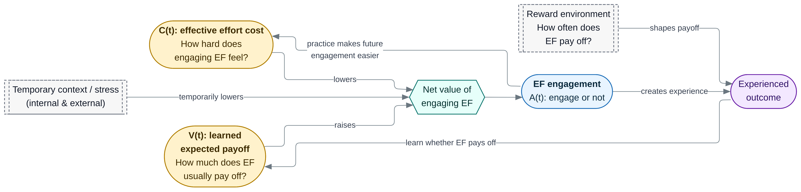

# DEV-Control model

This repository contains the code and generated results for:

> **Individual Differences in Executive-Function Engagement Can Emerge Without Differences in Neurodevelopmental Capacity: A Developing Expected Value of Control Model**  
> Kyuri Park and Yuko Munakata  
> Manuscript in preparation for *Developmental Science*

The model asks a simple question: **can stable differences in executive-function engagement emerge even when agents do not differ in capacity?**

At each opportunity, an agent decides whether engaging executive function is worthwhile. The decision depends on:

- the learned expected payoff of engaging, \(V\)
- the current effective effort cost, \(C\)
- temporary contextual demands, \(X\)

Engagement then changes future decisions in two ways. Experienced outcomes update expected payoff, while practice lowers future effort cost.

<p align="center">
  
</p>

## Reproducing the analyses

The analyses require R 4.2 or later and these packages:

```r
install.packages(c(
  "dplyr",
  "ggplot2",
  "patchwork",
  "scales",
  "tidyr"
))
```

`svglite` is optional and is only needed for SVG output.

From the project root, run:

```sh
Rscript run_all.R
```

This runs all six simulations and the developmental-window robustness check. Numerical outputs are written to `results/`, and Figures 2–7 plus the supplementary figures are written to `figures/`.

The full run takes about 10 minutes on the machine used for the manuscript.

Figure 1 is built separately from the Mermaid source in `figure1/`.

## Analysis map

| Script | Question | Main output |
|---|---|---|
| `01_nested_models.R` | What do value learning and practice each add? | Figure 2 |
| `02_identical_starts.R` | Can individual differences emerge from identical starts, and do they persist? | Figure 3, Figure S2 |
| `03_environment.R` | Do persistent reward-environment differences make engagement rankings more stable? | Figure 4 |
| `04_temporary_stress.R` | What remains after a temporary increase in contextual cost? | Figure 5, Figure S3 |
| `05_support_timing.R` | Does the same temporary reward boost have a larger effect when it occurs earlier? | Figure 6, Figure S4 |
| `06_parameter_sweep.R` | Do the main patterns hold across different parameter values? | Figure 7, Table S1 |
| `07_window_robustness.R` | Do the conclusions depend on the chosen early, middle, and late periods? | Figure S1 |

Each script can also be run on its own from the project root.

## Repository structure

```text
R/
  model.R          model and default parameters
  metrics.R        developmental periods and summary measures
  plot_style.R     shared figure style

analysis/
  one script for each simulation or robustness check

results/
  generated CSV files and R session information

figures/
  PDF, PNG, and SVG exports

figure1/
  Mermaid source, rendered files, and an editable PowerPoint version

archive/
  earlier development notebooks; not needed to reproduce the paper
```

## Reproducibility notes

- Time represents repeated opportunities to engage executive function, not literal days or years.
- Simulations 1–5 use the same 20 seeds (`1001:1020`).
- Conditions compared directly, such as stress and its reference condition, use the same seed and therefore differ only in the manipulation.
- Simulation 6 uses five independently seeded runs for each of the 250 parameter combinations.
- The first 1,500 steps of the extended Simulation 2 runs match the Simulation 1 runs with the same seed.
- The `SD = 0` condition in Simulation 3 is the same shared-environment condition used in Simulation 1.
- The parameter values are illustrative rather than fitted estimates. Simulation 6 and the supplementary checks show how much the results depend on them.

The R and package versions used for the current outputs are recorded in `results/session_info.txt`.

## Rebuilding Figure 1

From the project root:

```sh
cd figure1
./render_figure1.sh
```

The required Mermaid and Playwright setup is listed at the top of `render_figure1.sh`.

## Citation and license

The code is released under the MIT License. Citation metadata are provided in `CITATION.cff` and will be updated when the manuscript is publicly available.
