## Computational Model ? {.scrollable}

::: {.r-stack}
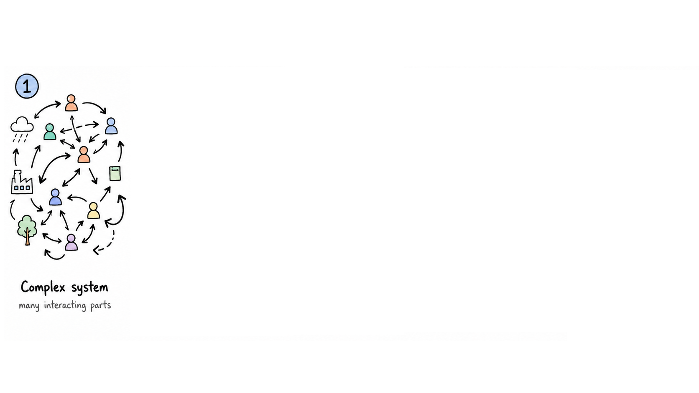{.absolute .fragment fragment-index="1"  top="0" left="0" width="900"} 
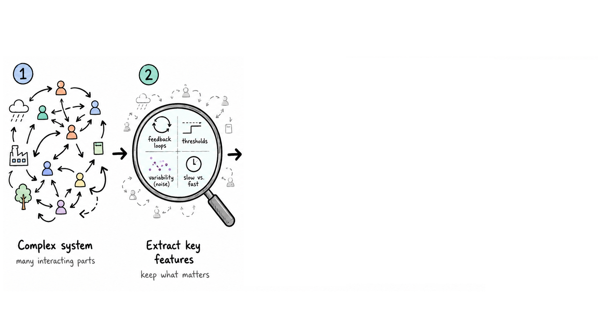{.absolute .fragment fragment-index="2" top="0" left="0" width="900"} 
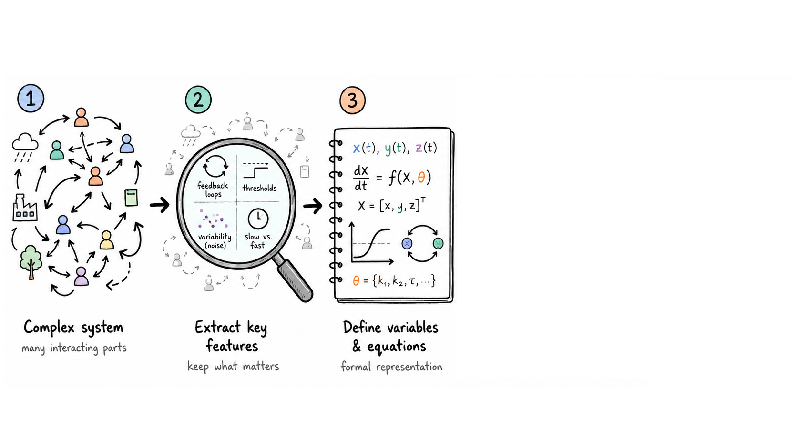{.fragment .absolute fragment-index="3" top="0" left="0" width="900"}
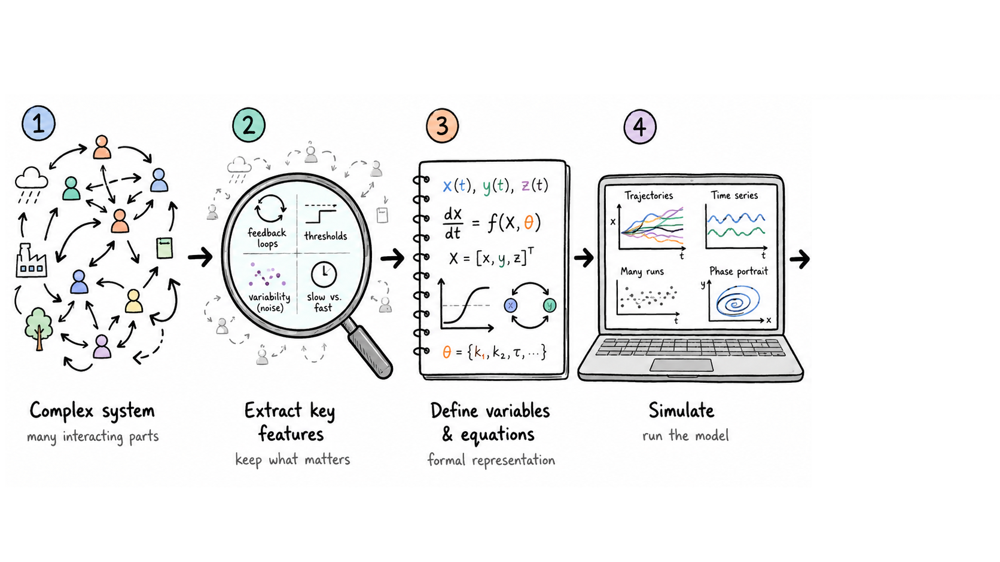{.fragment .absolute fragment-index="4" top="0" left="0" width="900"}
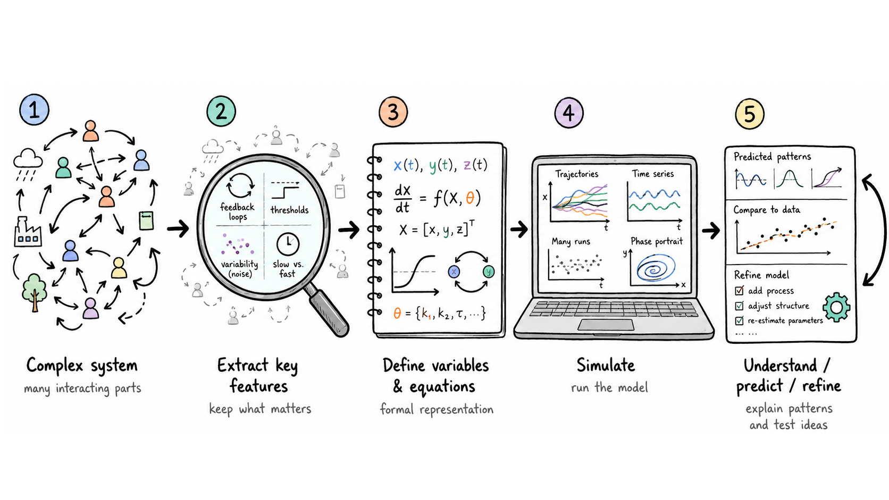{.fragment .absolute fragment-index="5" top="0" left="0" width="900"}

:::


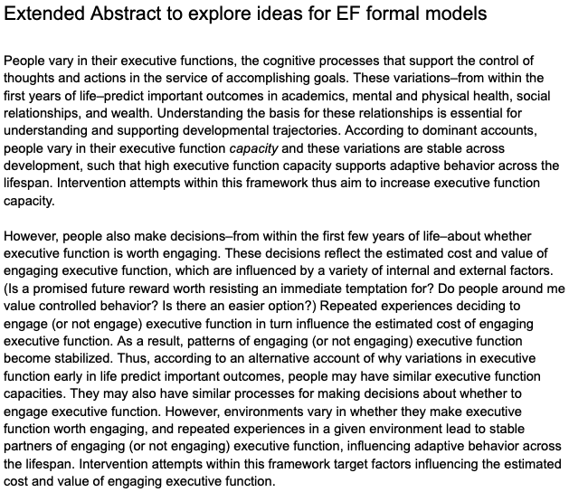{.absolute top="700" left="1"}
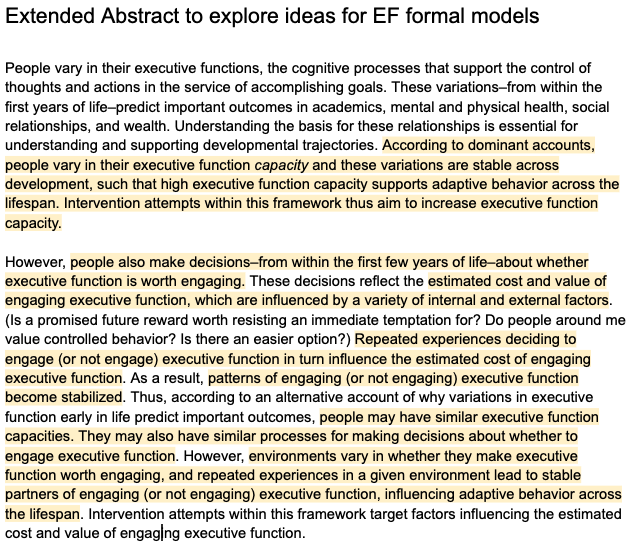{.fragment .absolute fragment-index="6" top="699" left="0"}

---

## What are the key features? {.scrollable}

::: {.columns}
::: {.column width="40%"}

**EF engagement**  
Moment-to-moment decision


**EF Capacity**  
Gradual developmental states

:::

::: {.column width="60%" .fragment}

Children’s EF engagement is modeled as a [slow–fast dynamical system]{.hl}.
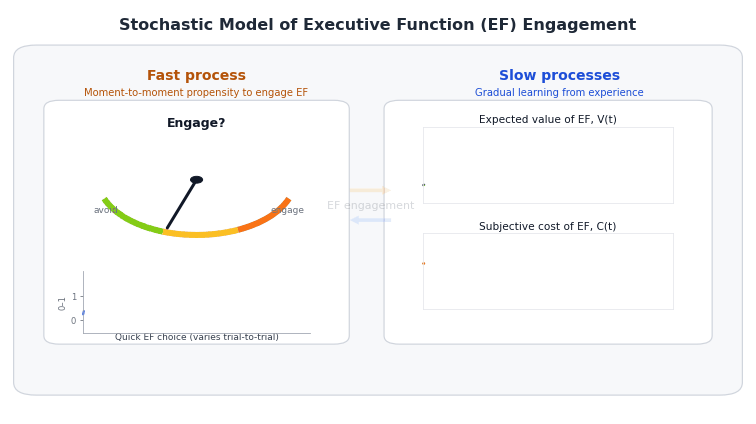{fig-align="center" width="120%"}

:::
:::


::: {.fragment .smaller .hl}
<div class="takeaway">
→ Small moment-to-moment engagement decisions accumulate into slower developmental change.
</div>
:::

::: notes
*Is EF worth engaging right now?*
:::


---


## What are the key features? (cont.)

::: incremental
1. **Stable individual differences** — small early differences in payoff or baseline effort compound over development
2. **Typical developmental improvement** — capacity grows via maturation and practice
3. **Transient dips under stress** — extra situational load temporarily suppresses engagement
4. **Intervention timing effects** — early reward-based interventions have larger lasting impact than late ones
:::


::: {.callout-note icon="false" title="Central idea :-)" .fragment}
Children learn whether executive function (EF) is worth engaging. At the same time, repeated engagement can build capacity, especially during earlier developmental windows when growth opportunity is higher.
:::


---

# Formal Representation (Model) {background-color="#107895"}


## Model overview: two coupled timescales {.scrollable}

<br>

::::: {.columns .smaller}
:::: {.column width="40%"}
::: {.fast-box}
[Fast state]{.hl}  
*Moment-to-moment*
***E(t)***:EF engagement propensity
:::
::::

::: {.column width="10%" .fragment}
<div class="coupling-arrow">⇄</div>
:::

:::: {.column width="50%"}
::: {.slow-box}
[Slow states]{.hl}  
*Weeks to years*  
***V(t)***: learned value of EF  
***C(t)***: subjective effort cost  
***K(t)***: EF capacity
:::

::::
:::::

::::::::: {.fragment}
<div class="takeaway">
[***Feedback***]{.hl}: Fast engagement is shaped by slow developmental states and repeated engagement feeds back into them.
</div>
::::::::: 

<br>
<br>

### ***Model diagram***

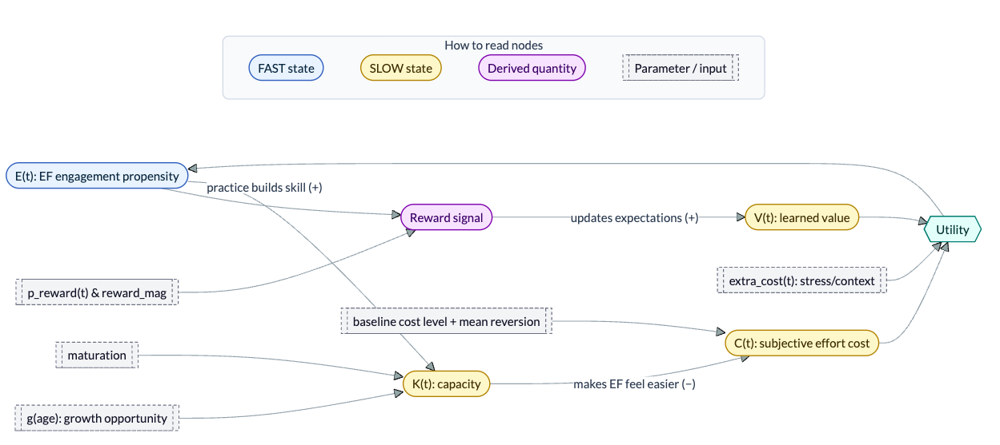{fig-align="center" width="100%"}

::: {.smaller .fragment}
$$
E(t)\uparrow
\Rightarrow
K(t)\uparrow
\Rightarrow
C(t)\downarrow
\Rightarrow
E(t)\uparrow
$$

:::

::: notes
EF engagement depends on current utility:
➜ Engagement is not only an outcome. It becomes a developmental input.
:::


---

# Fast Process {background-color="#107895"}

## EF Engagement Propensity: E(t) {.smaller .scrollable}

At each moment, the child computes a decision utility:

$$
U(t)=V(t)-[C(t)+\text{extra\_cost}(t)].
$$

The model maps this utility into EF engagement probability using a logistic function:

$$
E(t)=\sigma\left(\frac{U(t)}{\tau}\right),
\qquad
\sigma(x)=\frac{1}{1+e^{-x}}.
$$


<br>

| Term | Meaning |
|------|---------|
| $V(t)$ | Learned expected value of engaging EF |
| $C(t)$ | Subjective effort cost |
| $\text{extra\_cost}(t)$ | Temporary situational load (e.g., stress) |
| $\tau$ | Decision temperature — higher $\tau$ = less sensitive to value–cost difference |


<br>
<br>

::: {.fragment}
::: {.callout-note icon="false" title="Interpretation" .fragment}

- If $V(t) > C(t)+\text{extra\_cost}(t)$, then $U(t)>0$, and EF engagement becomes more likely.
- If $V(t) < C(t)+\text{extra\_cost}(t)$, then $U(t)<0$, and EF engagement becomes less likely.
- $\tau$ is the **decision temperature**. Larger $\tau$ makes the child less sensitive to value--cost differences.

:::
:::


::: notes
The fast layer asks: Is EF worth it right now?
:::


---

# Slow Processes {background-color="#107895"}

## EF Capacity: K(t) {.smaller}

$K(t)\in[0,1]$ is a **slow developmental state** driven by maturation and practice:

$$
\frac{dK(t)}{dt}
=
\underbrace{g(a)}_{\substack{\text{growth}\\\text{opportunity}}}
\times
\underbrace{\left[\rho_{\text{mat}}+\rho_{\text{prac}}E(t)\right]}_{\substack{\text{maturation}\\+\ \text{practice}}}
\times
\underbrace{\left(1-K(t)\right)}_{\substack{\text{developmental}\\\text{headroom}}}
$$

::: columns
::: {.column width="32%"}
#### $g(a)$
Age-dependent **growth opportunity** — high earlier in development, lower later
:::

::: {.column width="32%"}
#### $\rho_{\text{mat}}+\rho_{\text{prac}}E(t)$
Growth drive from **maturation** plus **engagement-driven practice**
:::

::: {.column width="32%"}
#### $1-K(t)$
Remaining developmental headroom — growth slows as capacity approaches its upper bound
:::
:::


<br>
<br>
<br>
<br>
<br>

Each factor has a different role:

| Term | Meaning |
|---|---|
| $g(a)$ | age-dependent developmental growth opportunity |
| $\rho_{\text{mat}}$ | background maturational growth |
| $\rho_{\text{prac}}E(t)$ | practice-based growth from EF engagement |
| $1-K(t)$ | remaining developmental headroom                                    |


## Growth opportunity: $g(a)$ {.smaller}

:::: {.columns}

::: {.column width="45%"}

The model uses a decreasing logistic function:

$$
g(a)=\frac{1}{1+\exp\left(\frac{a-a_{\text{mid}}}{w}\right)}
$$

| Symbol | Meaning |
|---|---|
| $a$ | age |
| $a_{\text{mid}}$ | the transition midpoint; age where $g(a)=0.5$ |
| $w$ | age-smoothness parameter: controls how gradual the age transition is|


:::

::: {.column width="55%"}

```{r}
#| label: fig_growth_opportunity_slide
#| echo: false
#| fig-width: 6.5
#| fig-height: 4.2
#| fig-align: "center"

library(ggplot2)
library(dplyr)
library(tidyr)

mid_age_demo <- 16.5

transition_demo <- expand_grid(
  age = seq(4, 30, length.out = 500),
  transition_width = c(1, 2.5, 5)
) %>%
  mutate(
    growth_opportunity =
      1 / (1 + exp((age - mid_age_demo) / transition_width)),
    transition_width = factor(
      transition_width,
      levels = c(1, 2.5, 5),
      labels = c("w = 1: sharp", "w = 2.5: default", "w = 5: gradual")
    )
  )

ggplot(transition_demo, aes(age, growth_opportunity, color = transition_width)) +
  geom_line(linewidth = 1.1) +
  geom_vline(
    xintercept = mid_age_demo,
    linetype = "dashed",
    color = "#6B7280",
    linewidth = 0.4
  ) +
  coord_cartesian(ylim = c(0, 1)) +
  theme_minimal(base_size = 14) +
  theme(
    panel.grid.minor = element_blank(),
    legend.position = "bottom",
    legend.title = element_blank()
  ) +
  labs(
    x = "Age",
    y = "g(age): growth opportunity"
  )
```

- smaller $w$ = sharper transition</p>
- larger $w$ = more gradual transition</p>


:::

::::


::: {.callout-note icon="false" title="$g(a)$ means..." .fragment}
How open is capacity to change at this age?  
So, ***the key point is that $g(a)$ scales how much maturation and practice can change capacity at that age.***
:::


<br>
<br>


### Why timing matters {.smaller}

$g(a)$ does not directly set capacity.  
It changes the **growth rate** of capacity:

$$
\frac{dK(t)}{dt}
=
g(a)
\left[\rho_{\text{mat}}+\rho_{\text{prac}}E(t)\right]
\left(1-K(t)\right)
$$

::: {.columns}
::: {.column width="50%"}

::: {.fast-box}
***When $g(a)$ is high***

The same engagement history produces **more capacity growth**.

Earlier development is more open to change.
:::

:::

::: {.column width="50%"}

::: {.slow-box}
***When $g(a)$ is low***

The same engagement history produces **less capacity growth**.

Later compensation is possible, but weaker.
:::

:::
:::

::: {.fragment}
<div class="takeaway">
➜ Low engagement early can matter more than low engagement later.
</div>
:::


## Value Learning: V(t) {.smaller}

$V(t)$ is the child’s learned belief that *using EF is worth it*.


***Momentary expected reward signal***

$$
R^{\text{exp}}(t)
=
\underbrace{E(t)}_{\substack{\text{propensity}\\\text{of engaging EF}}}
\cdot
\underbrace{p_{\text{reward}}(t)}_{\substack{\text{probability reward}\\\text{if EF is engaged}}}
\cdot
\underbrace{\text{reward\_mag}}_{\substack{\text{reward}\\\text{size}}}
$$


| Term | Meaning |
|---|---|
| $E(t)$ | probability/propensity of engaging EF |
| $p_{\text{reward}}(t)$ | probability that EF engagement pays off |
| $\text{reward\_mag}$ | size of payoff if reward occurs |
| $R^{\text{exp}}(t)$ | expected reward signal at time $t$: the probability that the child **engages EF and gets rewarded for it** at that moment|


::: {.callout-note icon="false" title="This is the expected value of a simple random payoff:"}


The model uses the **expected reward signal**, not a randomly sampled 0/1 reward event:

$$
R^{\text{exp}}(t)
=
\mathbb{E}[\text{payoff}(t)]
=
E(t)\,p_{\text{reward}}(t)\,\text{reward\_mag}
$$

Here, $E(t)p_{\text{reward}}(t)$ is the expected probability of both engaging EF and receiving reward.
:::

<br>
<br>
<br>
<br>
<br>
<br>
<br>
<br>


***Value update***

Then value learns toward this expected reward signal:

$$
dV(t)
=
\underbrace{\alpha_V}_{\substack{\text{learning}\\\text{rate}}}
{\color{#9a2515}
\underbrace{\bigl[R^{\text{exp}}(t)-V(t)\bigr]}_{\substack{\text{prediction}\\\text{error}}}
}
\,dt
+
\underbrace{\sigma_V dW_V(t)}_{\substack{\text{random}\\\text{fluctuation}}}
$$

<br>


::: {.fragment}

#### Prediction error intuition

- If $R^{\text{exp}}(t) > V(t)$: EF pays off *more than expected* $\Rightarrow V(t)\uparrow$
- If $R^{\text{exp}}(t) < V(t)$: EF pays off *less than expected* $\Rightarrow V(t)\downarrow$
- If $R^{\text{exp}}(t) \approx V(t)$: expectation is about right $\Rightarrow V(t)$ changes little
:::


::: notes

$p_{\text{reward}}$ is the key [intervention lever]{.hl}.

:::


## Subjective Cost: C(t) {.smaller}

$C(t)$ captures *how effortful EF feels*, shaped by two forces:

$$
dC(t)
=
\left[
\underbrace{\eta_C\bigl(C_{\text{set}}-C(t)\bigr)}_{\substack{\text{return to default}\\\text{effort level}}}
-
\underbrace{\beta_KK(t)}_{\substack{\text{capacity lowers}\\\text{felt effort}}}
\right]dt
+
\underbrace{\sigma_CdW_C(t)}_{\substack{\text{random}\\\text{fluctuation}}}
$$

::: columns
::: {.column width="48%" .fragment}

[**Force 1 — Mean reversion**]{style="color:#9a2515;"}

Cost reverts toward $C_{\text{set}}$: the child's trait-level *default effortfulness* of EF.

- $\eta_C$ controls reversion speed; 
- $C_{\text{set}}$ is a stable individual difference.

:::

::: {.column width="48%" .fragment}
[**Force 2 — Capacity reduction**]{style="color:#9a2515;"}

As $K(t)$ grows, EF feels progressively *easier*, persistently shifting cost downward.

- $\beta_K$ controls how strongly skill translates into effort reduction.
:::
:::

<br>


::: {.callout-note icon="false" title="What does it imply?" .fragment}
Children who build higher capacity experience lower subjective effort $\longrightarrow$ sustaining higher EF engagement long-term.
:::


---

# The Feedback Loop {background-color="#107895"}


## A Reinforcing Developmental Loop {.smaller}

::: {.r-stack .loop-stack}

<!-- STEP 0: base diagram, visible first, fades out when Step 1 appears -->
::: {.loop-panel .fragment .fade-out data-fragment-index="1"}
::: {.loop-diagram}

```{mermaid}
%%{init: {"theme":"base","flowchart":{"useMaxWidth":false},"themeVariables":{"fontFamily":"Inter, system-ui, Arial"}}}%%
flowchart LR

classDef fast fill:#E8F4FF,stroke:#1E6FB9,stroke-width:1.5px,color:#0B2A3D;
classDef slow fill:#FFF2CC,stroke:#B07D00,stroke-width:1.5px,color:#3D2B00;
classDef derived fill:#F3E8FF,stroke:#6B21A8,stroke-width:1.5px,color:#2E1065;
classDef utility fill:#E6FFFA,stroke:#0F766E,stroke-width:1.5px,color:#042F2E;
classDef param fill:#F3F4F6,stroke:#6B7280,stroke-width:1.2px,color:#111827,stroke-dasharray: 4 3;

subgraph MAIN[" "]
direction LR

U{{Utility}}:::utility --> E(["E(t): EF engagement propensity"]):::fast

V(["V(t): learned value"]):::slow --> U
C(["C(t): subjective effort cost"]):::slow --> U
X[["extra_cost(t): stress/context"]]:::param --> U

E --> Rexp([Reward signal]):::derived
p[["p_reward(t) & reward_mag"]]:::param --> Rexp
Rexp -->|"updates expectations (+)"| V

M[["maturation"]]:::param --> K(["K(t): capacity"]):::slow
G[["g(age): growth opportunity"]]:::param --> K
E -->|"practice builds skill (+)"| K

Cbase[["baseline cost level + mean reversion"]]:::param --> C
K -->|"makes EF feel easier (−)"| C

end
style MAIN fill:transparent,stroke:transparent

linkStyle default stroke:#CBD5E1,stroke-width:1.2px;
```

:::

<div class="loop-eq">

$$
E(t)\uparrow
\;\Rightarrow\;
K(t)\uparrow
\;\Rightarrow\;
C(t)\downarrow
\;\Rightarrow\;
U(t)\uparrow
\;\Rightarrow\;
E(t)\uparrow
$$

</div>

<div class="loop-text">
The model contains a reinforcing developmental feedback loop.
</div>
:::


<!-- STEP 1: E -> K -->
::: {.loop-panel .fragment .current-visible data-fragment-index="1"}
::: {.loop-diagram}

```{mermaid}
%%{init: {"theme":"base","flowchart":{"useMaxWidth":false},"themeVariables":{"fontFamily":"Inter, system-ui, Arial"}}}%%
flowchart LR

classDef fast fill:#E8F4FF,stroke:#1E6FB9,stroke-width:1.5px,color:#0B2A3D;
classDef slow fill:#FFF2CC,stroke:#B07D00,stroke-width:1.5px,color:#3D2B00;
classDef derived fill:#F3E8FF,stroke:#6B21A8,stroke-width:1.5px,color:#2E1065;
classDef utility fill:#E6FFFA,stroke:#0F766E,stroke-width:1.5px,color:#042F2E;
classDef param fill:#F3F4F6,stroke:#6B7280,stroke-width:1.2px,color:#111827,stroke-dasharray: 4 3;

subgraph MAIN[" "]
direction LR

U{{Utility}}:::utility --> E(["E(t): EF engagement propensity"]):::fast

V(["V(t): learned value"]):::slow --> U
C(["C(t): subjective effort cost"]):::slow --> U
X[["extra_cost(t): stress/context"]]:::param --> U

E --> Rexp([Reward signal]):::derived
p[["p_reward(t) & reward_mag"]]:::param --> Rexp
Rexp -->|"updates expectations (+)"| V

M[["maturation"]]:::param --> K(["K(t): capacity"]):::slow
G[["g(age): growth opportunity"]]:::param --> K
E -->|"practice builds skill (+)"| K

Cbase[["baseline cost level + mean reversion"]]:::param --> C
K -->|"makes EF feel easier (−)"| C

end
style MAIN fill:transparent,stroke:transparent

linkStyle default stroke:#CBD5E1,stroke-width:1.2px;
linkStyle 9 stroke:#9a2515,stroke-width:4px;
```

:::

<div class="loop-eq">

$$
{\color{#9a2515}E(t)\uparrow \;\Rightarrow\; K(t)\uparrow}
\;\Rightarrow\;
C(t)\downarrow
\;\Rightarrow\;
U(t)\uparrow
\;\Rightarrow\;
E(t)\uparrow
$$

</div>

<div class="loop-text">
Engagement provides practice, which builds capacity.
</div>
:::


<!-- STEP 2: K -> C -->
::: {.loop-panel .fragment .current-visible data-fragment-index="2"}
::: {.loop-diagram}

```{mermaid}
%%{init: {"theme":"base","flowchart":{"useMaxWidth":false},"themeVariables":{"fontFamily":"Inter, system-ui, Arial"}}}%%
flowchart LR

classDef fast fill:#E8F4FF,stroke:#1E6FB9,stroke-width:1.5px,color:#0B2A3D;
classDef slow fill:#FFF2CC,stroke:#B07D00,stroke-width:1.5px,color:#3D2B00;
classDef derived fill:#F3E8FF,stroke:#6B21A8,stroke-width:1.5px,color:#2E1065;
classDef utility fill:#E6FFFA,stroke:#0F766E,stroke-width:1.5px,color:#042F2E;
classDef param fill:#F3F4F6,stroke:#6B7280,stroke-width:1.2px,color:#111827,stroke-dasharray: 4 3;

subgraph MAIN[" "]
direction LR

U{{Utility}}:::utility --> E(["E(t): EF engagement propensity"]):::fast

V(["V(t): learned value"]):::slow --> U
C(["C(t): subjective effort cost"]):::slow --> U
X[["extra_cost(t): stress/context"]]:::param --> U

E --> Rexp([Reward signal]):::derived
p[["p_reward(t) & reward_mag"]]:::param --> Rexp
Rexp -->|"updates expectations (+)"| V

M[["maturation"]]:::param --> K(["K(t): capacity"]):::slow
G[["g(age): growth opportunity"]]:::param --> K
E -->|"practice builds skill (+)"| K

Cbase[["baseline cost level + mean reversion"]]:::param --> C
K -->|"makes EF feel easier (−)"| C

end
style MAIN fill:transparent,stroke:transparent

linkStyle default stroke:#CBD5E1,stroke-width:1.2px;
linkStyle 11 stroke:#9a2515,stroke-width:4px;
```

:::

<div class="loop-eq">

$$
E(t)\uparrow
\;\Rightarrow\;
{\color{#9a2515}K(t)\uparrow \;\Rightarrow\; C(t)\downarrow}
\;\Rightarrow\;
U(t)\uparrow
\;\Rightarrow\;
E(t)\uparrow
$$

</div>

<div class="loop-text">
Higher capacity makes EF feel easier.
</div>
:::


<!-- STEP 3: C -> U -> E -->
::: {.loop-panel .fragment .current-visible data-fragment-index="3"}
::: {.loop-diagram}

```{mermaid}
%%{init: {"theme":"base","flowchart":{"useMaxWidth":false},"themeVariables":{"fontFamily":"Inter, system-ui, Arial"}}}%%
flowchart LR

classDef fast fill:#E8F4FF,stroke:#1E6FB9,stroke-width:1.5px,color:#0B2A3D;
classDef slow fill:#FFF2CC,stroke:#B07D00,stroke-width:1.5px,color:#3D2B00;
classDef derived fill:#F3E8FF,stroke:#6B21A8,stroke-width:1.5px,color:#2E1065;
classDef utility fill:#E6FFFA,stroke:#0F766E,stroke-width:1.5px,color:#042F2E;
classDef param fill:#F3F4F6,stroke:#6B7280,stroke-width:1.2px,color:#111827,stroke-dasharray: 4 3;

subgraph MAIN[" "]
direction LR

U{{Utility}}:::utility --> E(["E(t): EF engagement propensity"]):::fast

V(["V(t): learned value"]):::slow --> U
C(["C(t): subjective effort cost"]):::slow --> U
X[["extra_cost(t): stress/context"]]:::param --> U

E --> Rexp([Reward signal]):::derived
p[["p_reward(t) & reward_mag"]]:::param --> Rexp
Rexp -->|"updates expectations (+)"| V

M[["maturation"]]:::param --> K(["K(t): capacity"]):::slow
G[["g(age): growth opportunity"]]:::param --> K
E -->|"practice builds skill (+)"| K

Cbase[["baseline cost level + mean reversion"]]:::param --> C
K -->|"makes EF feel easier (−)"| C

end
style MAIN fill:transparent,stroke:transparent

linkStyle default stroke:#CBD5E1,stroke-width:1.2px;
linkStyle 2 stroke:#9a2515,stroke-width:4px;
linkStyle 0 stroke:#9a2515,stroke-width:4px;
```

:::

<div class="loop-eq">

$$
E(t)\uparrow
\;\Rightarrow\;
K(t)\uparrow
\;\Rightarrow\;
{\color{#9a2515}C(t)\downarrow \;\Rightarrow\; U(t)\uparrow \;\Rightarrow\; E(t)\uparrow}
$$

</div>

<div class="loop-text">
Lower cost raises utility, making future engagement more likely.
</div>
:::


<!-- STEP 4: full loop -->
::: {.loop-panel .fragment .current-visible data-fragment-index="4"}
::: {.loop-diagram}

```{mermaid}
%%{init: {"theme":"base","flowchart":{"useMaxWidth":false},"themeVariables":{"fontFamily":"Inter, system-ui, Arial"}}}%%
flowchart LR

classDef fast fill:#E8F4FF,stroke:#1E6FB9,stroke-width:1.5px,color:#0B2A3D;
classDef slow fill:#FFF2CC,stroke:#B07D00,stroke-width:1.5px,color:#3D2B00;
classDef derived fill:#F3E8FF,stroke:#6B21A8,stroke-width:1.5px,color:#2E1065;
classDef utility fill:#E6FFFA,stroke:#0F766E,stroke-width:1.5px,color:#042F2E;
classDef param fill:#F3F4F6,stroke:#6B7280,stroke-width:1.2px,color:#111827,stroke-dasharray: 4 3;

subgraph MAIN[" "]
direction LR

U{{Utility}}:::utility --> E(["E(t): EF engagement propensity"]):::fast

V(["V(t): learned value"]):::slow --> U
C(["C(t): subjective effort cost"]):::slow --> U
X[["extra_cost(t): stress/context"]]:::param --> U

E --> Rexp([Reward signal]):::derived
p[["p_reward(t) & reward_mag"]]:::param --> Rexp
Rexp -->|"updates expectations (+)"| V

M[["maturation"]]:::param --> K(["K(t): capacity"]):::slow
G[["g(age): growth opportunity"]]:::param --> K
E -->|"practice builds skill (+)"| K

Cbase[["baseline cost level + mean reversion"]]:::param --> C
K -->|"makes EF feel easier (−)"| C

end
style MAIN fill:transparent,stroke:transparent

linkStyle default stroke:#CBD5E1,stroke-width:1.2px;
linkStyle 9 stroke:#9a2515,stroke-width:4px;
linkStyle 11 stroke:#9a2515,stroke-width:4px;
linkStyle 2 stroke:#9a2515,stroke-width:4px;
linkStyle 0 stroke:#9a2515,stroke-width:4px;
```

:::

<div class="loop-eq">

$$
{\color{#9a2515}
E(t)\uparrow
\;\Rightarrow\;
K(t)\uparrow
\;\Rightarrow\;
C(t)\downarrow
\;\Rightarrow\;
U(t)\uparrow
\;\Rightarrow\;
E(t)\uparrow
}
$$

</div>

<div class="loop-takeaway">
Engagement is not only an outcome. It becomes a developmental input.
</div>
:::

:::


# Simulation {background-color="#107895"}

## Simulation setup: main code logic {.scrollable .smaller}


:::: {.columns}
::: {.column width="42%"}

#### Parameter values used in the demo

| Parameter | Value | Meaning |
|---|---:|---|
| `age0` | 4 | start age |
| duration | 20 years | simulated window |
| `dt` | 0.1 week | one numerical step |
| `T_dev` | 10,401 | stored time points |
| `V0` | 0.10 | initial value |
| `C0` | 1.05 | initial cost |
| `K0` | 0.05 | initial capacity |
| `tau` | 0.45 | utility sensitivity |
| `p_reward` | 0.70 | reward chance |
| `reward_mag` | 2.00 | reward size |

:::

::: {.column width="58%"}

#### Main update logic

The code simulates a 20-year developmental trajectory by repeating the same update loop.


```r
# --- 1. Define the simulated time window ---

weeks_per_year <- 52
dt <- 0.1

# 20 years = 1040 weeks.
# With dt = 0.1 week, this gives 10400 update intervals.
# +1 because we also store the initial state at t = 0.
T_dev <- round(20 * weeks_per_year / dt) + 1


# --- 2. Set the starting state ---

age0 <- 4      # start age label
V[1] <- 0.10   # initial learned value of EF
C[1] <- 1.05   # initial subjective effort cost
K[1] <- 0.05   # initial EF capacity


# --- 3. Repeat this update for each time step ---

for (i in 1:(T_dev - 1)) {

  # Current age in years
  age_i <- age0 + ((i - 1) * dt) / weeks_per_year

  # Age-dependent growth opportunity
  growth_i <- age_growth_multiplier(
    age_i,
    mid_age = growth_mid_age
  )

  # Fast decision: value minus total cost
  utility <- V[i] - (C[i] + extra_cost_vec[i])

  # Convert utility into EF engagement propensity
  E[i] <- 1 / (1 + exp(-utility / tau))

  # Expected reward from engaging EF
  p_i <- if (is.null(p_reward_vec)) p_reward else p_reward_vec[i]
  R_exp <- E[i] * p_i * reward_mag

  # Value learns toward expected reward
  dV_det <- alpha_V * (R_exp - V[i])

  # Cost returns toward baseline, but capacity lowers felt effort
  dC_det <- eta_C * (C_set - C[i]) - beta_K * K[i]

  # Capacity grows through maturation and practice,
  # scaled by growth opportunity and remaining headroom
  dK_det <- growth_i *
    (rho_mat + rho_prac * E[i]) *
    (1 - K[i])

  # Move one small numerical step forward
  V[i + 1] <- V[i] + dV_det * dt +
    sigma_V * sqrt(dt) * rnorm(1)

  C[i + 1] <- C[i] + dC_det * dt +
    sigma_C * sqrt(dt) * rnorm(1)

  K[i + 1] <- K[i] + dK_det * dt
}
```


:::
::::

$$
\text{age}
\rightarrow
U(t)
\rightarrow
E(t)
\rightarrow
R^{\exp}(t)
\rightarrow
\{V(t),C(t),K(t)\}
$$

<div class="takeaway">
`T_dev` is just the number of stored rows needed to represent 20 years with `dt = 0.1` week.
</div>


## Results: what the model generates {.scrollable .smaller}

::: {.panel-tabset}

### Result 1

#### Baseline development

::: {.columns}
::: {.column width="42%"}

This baseline simulation shows how the main states co-develop in a typical context.

**Mechanism**

<div style="font-size: 0.75em; line-height: 1.0;">

$$
\begin{aligned}
E\uparrow &\Rightarrow R^{\exp}\uparrow \Rightarrow V\uparrow \Rightarrow U\uparrow \Rightarrow E\uparrow \\
E\uparrow &\Rightarrow K\uparrow \Rightarrow C\downarrow \Rightarrow U\uparrow \Rightarrow E\uparrow
\end{aligned}
$$

</div>


[Baseline development emerges because engagement both increases learned value and builds capacity, while higher capacity lowers future effort cost.]{.hl}


:::
::: {.column width="58%"}

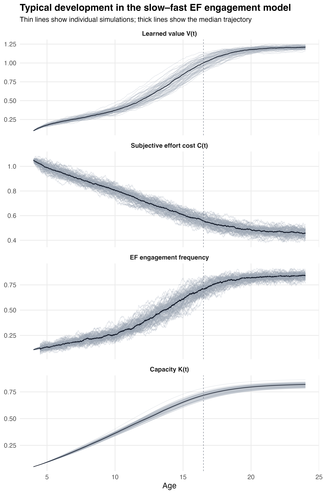{fig-align="center" width="100%"}

:::
:::


### Result 2

#### Stable individual differences

::: {.columns}
::: {.column width="42%"}

120 simulated children are simulated once from age 4 to 24.

All children use the **same equations**. They differ only in these child-specific values:

::: {.smallfont}
| Quantity | Exact setting |
|---|---:|
| $p_{\text{reward},i}$ | $N(0.70, 0.10)$, clipped to $[0,1]$ |
| $C_{\text{set},i}$ | $N(1.00, 0.14)$, bounded to $[0.70,1.35]$ |
| $V_{0i}$ | $N(0.10, 0.025)$, bounded to $[0.02,0.18]$ |
| $C_{0i}$ | $N(1.05, 0.08)$, bounded to $[0.80,1.30]$ |
| $K_{0i}$ | $N(0.05, 0.020)$, bounded to $[0.01,0.12]$ |
:::


<div style="font-size: 0.8em; line-height: 1.0;">

$$
p_{\text{reward},i}\uparrow,\; C_{\text{set},i}\downarrow
\Rightarrow E_i(t)\uparrow
\Rightarrow K_i(t)\uparrow
$$

</div>

[Small differences in reward context, effort cost, and initial state can become stable later differences in engagement and capacity.]{.hl}

:::
::: {.column width="58%"}

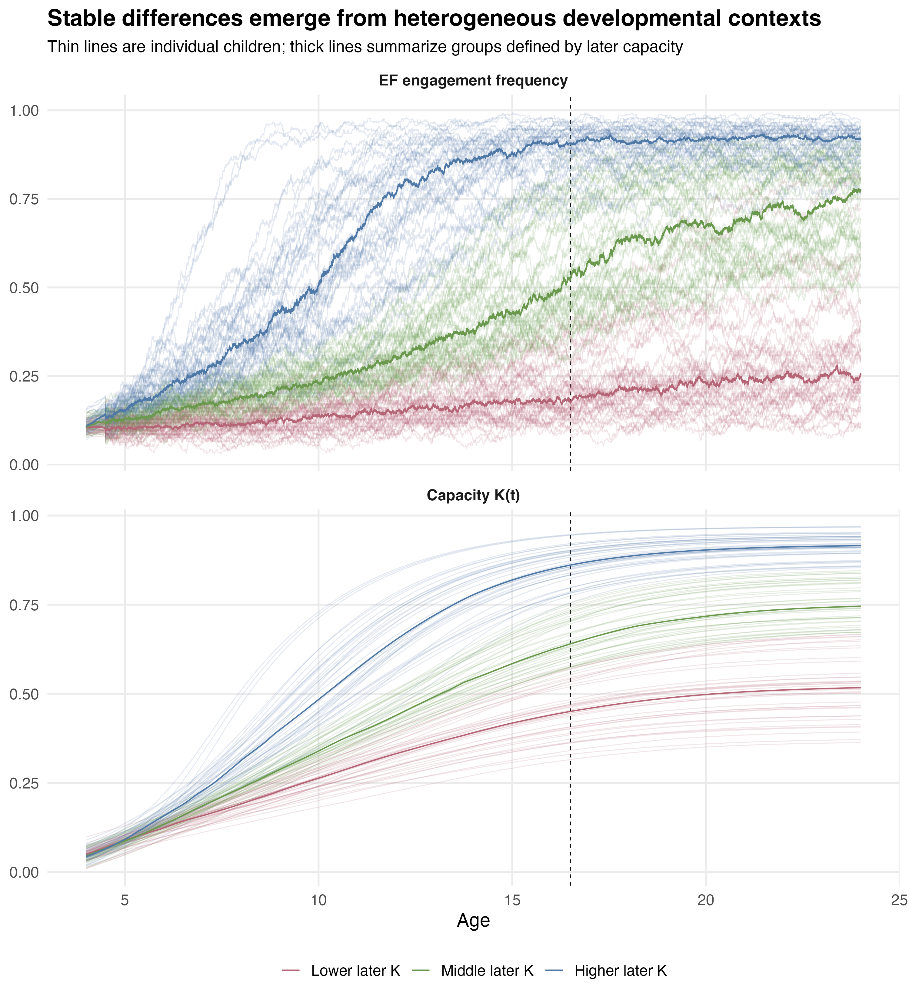{fig-align="center" width="100%"}

:::
:::


### Result 3

#### Stress pathway

::: {.columns}
::: {.column width="42%"}

Stress is added as a *temporary smooth increase in decision cost*.

::: {.smallfont}
| Condition | Extra-cost input |
|---|---|
| No stress | always 0 |
| Early stress | ages 7--11, peak = 1.20 at age 9 |
| Later stress | ages 18--22, peak = 1.20 at age 20 |
:::

<br>

It enters only the fast decision:

<div style="font-size: 0.8em; line-height: 1.0;">

$$
U(t)=V(t)-[C(t)+\text{extra\_cost}(t)]
$$

$$
E(t)=\frac{1}{1+\exp[-U(t)/\tau]}
$$
</div>


[Stress suppresses engagement by raising effective decision cost. Early stress can still be more developmentally consequential because it occurs while growth opportunity is high.]{.hl}


:::
::: {.column width="58%"}

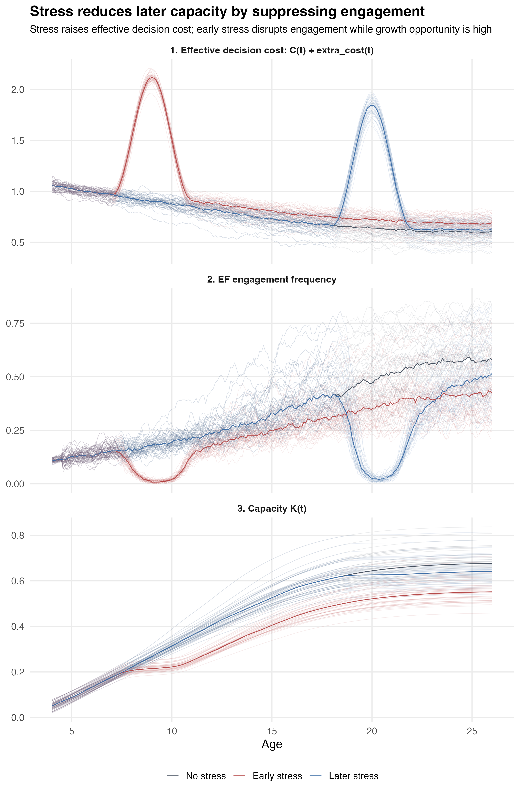{fig-align="center" width="100%"}

:::
:::


The stress input is a smooth bump:

$$
\text{extra\_cost}(t)
=
1.20 \cdot
\sin^2\left(
\pi\frac{\text{age}-\text{start}}{\text{end}-\text{start}}
\right)
$$


Although early and later stress have the same peak size, the later engagement dip is larger because baseline engagement is higher and closer to the steep part of the logistic decision curve. Early engagement is already low, so it is partly floor-limited.


### Result 4

#### Reward-support pathway

:::: {.columns}
::: {.column width="42%"}

Reward support changes the reward probability: $p_{\text{reward}}(t)$


::: {.smallfont}
| Condition | Reward-probability input |
|---|---|
| No support | fixed at child-specific baseline $p_{\text{base}}$ |
| Early support | smooth increase starting between ages 6--8 |
| Later support | same smooth increase starting between ages 18--20 |
:::


Reward affects value learning through expected reward:

<div style="font-size: 0.8em; line-height: 1.0;">


$$
R^{\exp}(t)=E(t)p_{\text{reward}}(t)\text{reward\_mag}
$$


$$
\begin{aligned}
p_{\text{reward}}\uparrow
&\Rightarrow R^{\exp}\uparrow
\Rightarrow V\uparrow
\Rightarrow E\uparrow 
\Rightarrow K\text{ grows faster}
\end{aligned}
$$


</div>

[Reward support raises capacity indirectly: first value, then engagement, then practice-based capacity growth.]{.hl}

:::
::: {.column width="58%"}

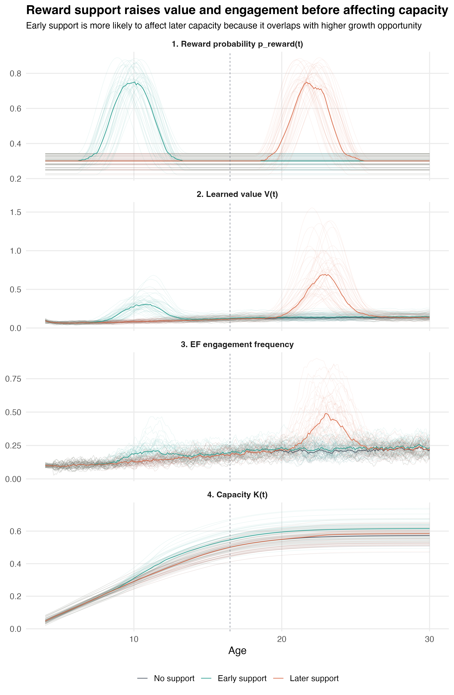{fig-align="center" width="100%"}

:::
::::

<br>
<br>


Exact settings:

::: {.smallfont}
| Quantity | Value |
|---|---:|
| simulated profiles | 45 |
| age range | 4--30 |
| $p_{\text{base}}$ | $N(0.30,0.035)$, clipped to $[0,1]$ |
| support duration | Uniform(5.0, 6.5 years) |
| support boost | Uniform(0.42, 0.56) |
| peak reward probability | $\min(0.92,\;p_{\text{base}}+\text{boost})$ |
:::


::: {.callout-note icon="false" title="Note"}

Although early and later support use similar reward-probability boosts, the later value and engagement hills are larger because reward support is multiplied by current engagement:

$$
R^{\exp}(t)=E(t)p_{\text{reward}}(t)\text{reward\_mag}
$$

Later in development, baseline engagement is already higher, so the same increase in $p_{\text{reward}}(t)$ produces a larger expected reward signal, a larger increase in $V(t)$, and therefore a larger temporary increase in engagement.

This does not mean later support is more important for capacity. Early support can still have a stronger developmental effect because it occurs when growth opportunity $g(a)$ is higher.
:::

:::

---


## Summary {.smaller}

::: columns
::: {.column width="48%"}
#### The model captures:

- How EF engagement emerges from learned value ($V$), subjective cost ($C$), and capacity ($K$)

- Why early individual differences persist through the $E \to K \to C \to E$ feedback loop: Small differences early → large consequences late.


- How stress and reward-based interventions shift developmental trajectories
:::

::: {.column width="48%"}
#### Next steps:

- Fit model to empirical data (calibrate the model)

- Formal sensitivity analysis of key parameters

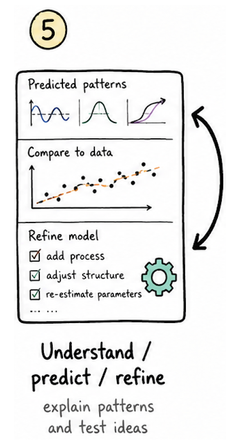{fig-align="center" width="50%"}

:::
:::


---

## Thank you {.smaller}

Any comments/questions?

::: columns
::: {.column width="60%"}
**Kyuri Park**
Computational Science Lab
University of Amsterdam
[k.park@uva.nl](mailto:k.park@uva.nl)  
[www.kyuripark.net](mailto:k.park@uva.nl) 
:::
